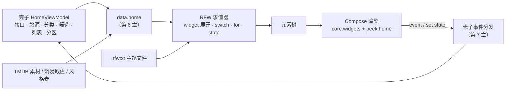

# 首页 DIY 主题开发文档

本文面向编写 Koreplay 移动端首页主题（`.rfwtxt`）的开发者，覆盖语法、数据、事件、组件、壳子扩展能力、生效规则与调试工具。阅读完本文，不需要看壳子源码也能写出一套完整的首页主题。

- 适用范围：Koreplay 移动端，设置 → 个性化 → **首页DIY**
- 数据契约版本：`data.home.contractVersion = 1`
- 主题格式：RFW（Remote Flutter Widgets）文本格式，与 PeekPro 1.6.3 的首页主题互通
- 本文中标注 **【壳子扩展】** 的能力只在 Koreplay 中可用，PeekPro 会忽略或报错；不带标注的写法两边通用

## 目录

1. [概述](#1-概述)
2. [快速开始](#2-快速开始)
3. [主题文件与存放位置](#3-主题文件与存放位置)
4. [语法](#4-语法)
5. [渲染模型](#5-渲染模型)
6. [数据契约 data.home](#6-数据契约-datahome)
7. [事件](#7-事件)
8. [参数取值格式](#8-参数取值格式)
9. [组件参考：core.widgets](#9-组件参考corewidgets)
10. [组件参考：peek.home](#10-组件参考peekhome)
11. [壳子扩展专题](#11-壳子扩展专题)
12. [沉浸取色](#12-沉浸取色)
13. [TMDB 素材](#13-tmdb-素材)
14. [生效规则与优先级](#14-生效规则与优先级)
15. [编辑器、预览与语法检查](#15-编辑器预览与语法检查)
16. [与 PeekPro 的兼容性](#16-与-peekpro-的兼容性)
17. [性能与最佳实践](#17-性能与最佳实践)
18. [常见问题](#18-常见问题)
19. [附录](#19-附录)

---

## 1. 概述

首页主题是一份声明式的界面描述文件。壳子负责拉取接口、站源、分类、筛选、列表等数据，把它们整理成 `data.home` 交给主题；主题只负责「把这些数据摆成什么样」以及「点了以后触发哪个动作」。



主题能做的：

- 任意排列分类、筛选、海报、轮播、分区、按钮，换配色、字号、圆角、阴影、渐变、毛玻璃。
- 根据横竖屏、显示样式、加载状态、TMDB 是否开启等数据用 `switch` 切换整套布局。
- 触发壳子提供的动作：选分类、选筛选、打开条目、换站源、换接口、搜索、历史、收藏、刷新等（第 7 章）。
- 【壳子扩展】组件本地状态、原地变形面板、抽屉、二级分类页、分区首页、多风格切换、下拉刷新（第 11 章）。

主题不能做的：

- 不能执行代码，没有运算表达式、函数、网络请求、文件读写。所有需要计算的尺寸由壳子在 `data.home.metrics` 里算好（第 6.7 节）。
- 不能直接修改壳子数据；只能通过事件请求壳子去做。
- 不能自己播放视频或打开任意网页；打开条目、搜索等都走壳子原生页面。

## 2. 快速开始

### 2.1 在手机上新建

1. 打开 **设置 → 个性化 → 首页DIY**。
2. 点 **新建或导入 → 新建主题**，填名称和一句话描述，点「创建并编辑」。
3. 把下面的源码粘贴进编辑器，切到「预览」页签就能看到效果；保存。
4. 回到主题详情页，打开 **启用这套主题**。首页立刻换成这套主题。

```rfwtxt
// 我的第一个主题：最简单的分类胶囊 + 海报网格首页。
import core.widgets;
import peek.home;

widget Poster = GestureDetector(
  onTap: event "openItem" { index: args.item.index },
  onLongPress: event "longPressItem" { index: args.item.index },
  child: Column(
    crossAxisAlignment: "start",
    children: [
      Expanded(
        child: ClipRRect(
          borderRadius: [ { x: 10.0 } ],
          child: T4Image(url: args.item.pic),
        ),
      ),
      Padding(
        padding: [ 2.0, 6.0, 2.0, 0.0 ],
        child: Text(
          text: args.item.name,
          maxLines: 1,
          overflow: "ellipsis",
          style: { color: 0xFF1F1D1A, fontSize: 13.0, fontWeight: "w600" },
        ),
      ),
    ],
  ),
);

widget Chip = GestureDetector(
  onTap: event "selectType" { typeId: args.item.typeId },
  child: Container(
    margin: [ 0.0, 8.0, 8.0, 8.0 ],
    padding: [ 14.0, 0.0 ],
    alignment: { x: 0.0, y: 0.0 },
    decoration: {
      type: "box",
      color: switch args.item.selected { true: 0xFF1F1D1A, false: 0xFFE9E6E0 },
      borderRadius: [ { x: 16.0 } ],
    },
    child: Text(
      text: args.item.typeName,
      style: {
        color: switch args.item.selected { true: 0xFFFFFFFF, false: 0xFF1F1D1A },
        fontSize: 13.0,
      },
    ),
  ),
);

widget ApiButton = GestureDetector(
  onTap: event "showApiConfigPicker" {},
  child: Container(
    width: 44.0,
    alignment: { x: 0.0, y: 0.0 },
    child: Icon(icon: data.home.icons.api, fontFamily: "MaterialIcons", size: 20.0, color: 0xFF1F1D1A),
  ),
);

widget root = Container(
  color: 0xFFF6F4F0,
  child: PeekStickyGrid(
    heroHeight: 0.0,
    pinnedHeight: 52.0,
    pinnedHeader: Container(
      color: 0xFFF6F4F0,
      child: Row(
        children: [
          Expanded(
            child: ListView(
              scrollDirection: "horizontal",
              padding: [ 12.0, 0.0 ],
              children: [
                ...for item in data.home.classes:
                  Chip(item: item),
              ],
            ),
          ),
          ApiButton(),
        ],
      ),
    ),
    sectionHeight: 0.0,
    sectionHeader: SizedBoxShrink(),
    empty: Center(
      child: Text(text: switch data.home.loading { true: "正在载入…", false: "暂无内容" }),
    ),
    crossAxisCount: data.home.gridColumns,
    childAspectRatio: 0.62,
    mainAxisSpacing: 14.0,
    crossAxisSpacing: 10.0,
    horizontalPadding: 14.0,
    bottomPadding: 110.0,
    children: [
      ...for item in data.home.items:
        Poster(item: item),
    ],
  ),
);
```

要点：

- 文件必须有一个 `widget root`，首页从它开始渲染。
- 所有尺寸写成**小数**（`13.0` 而不是 `13`），整数会被忽略。这是最常见的「改了没反应」原因，见 [4.3](#43-数字整数和小数是两种类型)。
- 滚动到底时 `PeekStickyGrid` 会自动请求下一页，不用自己写。

### 2.2 在电脑上写

1. 在电脑上用任意编辑器写 `.rfwtxt`（UTF-8）。
2. 拷贝到手机的 `/sdcard/Koreplay/home_themes/`。
3. 首页DIY → 新建或导入 → **重新扫描外部目录**，主题出现在「外部」分类里。
4. 外部主题是只读的：在手机上点「编辑源码」会提示另存为「我的主题」；想继续在电脑上改，覆盖文件后再扫描一次即可。

也可以用「从剪贴板导入」「从文件导入」把源码导进「我的主题」。

### 2.3 从内置主题开始

内置主题（[附录 19.2](#192-内置主题)）都是完整可用的范例。在主题详情页点 **复制为我的主题**，就得到一份可编辑的副本。写同类能力时直接对照：

| 想做 | 参考的内置主题 |
| --- | --- |
| 沉浸取色、TMDB 主视觉、通栏轮播 | 沉浸光影 |
| 分区首页、二级筛选页、原地变形面板、多风格、下拉刷新 | 百变Emby |
| 层叠轮播 | 暖阳影廊、云幕典藏、蓝天白云 |
| 超高 / 低矮 / 纤长 / 胖轮播 | 赤焰影院、雪境玻璃、极光棱镜、柔彩气泡 |
| 无轮播、排名与文字为主 | 午夜榜单、墨白极简、绿幕终端、银幕杂志 |
| 宽幅剧照墙 | 横向影廊 |

## 3. 主题文件与存放位置

### 3.1 文件格式

| 项目 | 要求 |
| --- | --- |
| 编码 | UTF-8；开头的 BOM 会被自动去掉；`\r\n` 自动转成 `\n` |
| 扩展名 | `.rfwtxt`；外部目录同时识别 `.peeklayout`（PeekPro 导出的同格式文件） |
| 入口 | 必须声明 `widget root` |
| 导入 | 建议写 `import core.widgets;` 和 `import peek.home;`。壳子渲染不依赖 import，但语法检查会提醒，PeekPro 不写会无法使用对应组件 |

### 3.2 描述与标签

文件里**第一行 `//` 注释**是主题描述：取「：」后面的部分显示在主题卡片和详情页。

```rfwtxt
// 沉浸光影：动态取色沉浸主视觉。同时开启 TMDB 集成和自动刮削后……
```

描述和源码里出现的关键词会自动生成卡片上的标签：

| 标签 | 触发条件 |
| --- | --- |
| 无轮播 / 层叠轮播 / 超高轮播 / 窄轮播 / 矮轮播 / 胖轮播 / 纤长轮播 | 描述或源码前 6 行里有「无轮播」「层叠」「超高」「窄」「矮 / 低矮」「胖」「纤长」 |
| 轮播 | 源码用到 `PeekCarousel` 且没命中上面的词 |
| 沉浸取色 | 用到 `PeekImmersive*` 组件，或描述里有「取色」 |
| 毛玻璃 | 用到 `PeekGlass` |
| TMDB | 源码引用了 TMDB 字段（见 [13.3](#133-何时会去拉取)） |
| 多风格 | 声明了 `widget skins { ... }` |

### 3.3 三种来源

| 来源 | 位置 | 可编辑 | 说明 |
| --- | --- | --- | --- |
| 内置 | APK 内 `assets/home_themes/` | 否 | 修改时另存为「我的主题」 |
| 我的 | 应用私有目录 `files/home_themes/`，文件名 `u<时间戳>.rfwtxt` | 是 | 新建、导入、复制都落在这里；名称和描述单独存，可随时改 |
| 外部 | `/sdcard/Koreplay/home_themes/` | 否 | 只读扫描，主题 id 为 `ext_<文件名>`；需要存储权限 |

主题的「导出为文件」会生成 `<主题名>.rfwtxt`；「分享源码」以纯文本分享。导入时会立即做语法检查，有问题也会导入，但会提示「有 N 个问题待修复」。

### 3.4 编译缓存

壳子按「主题 id + 源码哈希」缓存解析结果。源码不变时切站源、转屏、换数据都只重新求值，不重新解析；保存新源码后自动失效。

## 4. 语法

### 4.1 词法

| 元素 | 写法 | 说明 |
| --- | --- | --- |
| 行注释 | `// ...` | 到行尾 |
| 块注释 | `/* ... */` | 不能嵌套；没闭合会报错 |
| 整数 | `12`、`-3`、`0xFF1F1D1A` | 十六进制常用于颜色 |
| 小数 | `12.0`、`-0.5`、`1e3`、`1.5e-2` | 带小数点或指数的才是小数 |
| 字符串 | `"文字"` 或 `'文字'` | 转义：`\n \r \t \b \f \v \0 \\ \' \" \/ \uXXXX` |
| 布尔 | `true`、`false` | |
| 空 | `null` | 只能用在映射的值里，表示「不传这个参数」 |
| 标识符 | 字母或 `_` 开头，后接字母、数字、`_` | 中文也算字母，但不建议用作组件名 |
| 保留字 | `args data event false set state true` | 不能用作循环变量名 |

### 4.2 文件结构

```rfwtxt
import core.widgets;        // 0 到多条 import
import peek.home;

widget 名字 = 构造调用;      // 1 到多条 widget 声明，顺序无关
widget 名字 { 初始状态 } = 构造调用;   // 带本地状态的声明（【壳子扩展】可写）
widget 名字 = switch 值 { ... };       // 声明的根也可以是 switch
```

有特殊含义的声明名：

| 名字 | 作用 |
| --- | --- |
| `root` | 首页入口，必须有 |
| `categoryPage` | 【壳子扩展】二级分类页，见 [11.4](#114-二级分类页-categorypage) |
| `skins` | 【壳子扩展】多风格表，见 [11.6](#116-多风格-skins) |

同名声明以后面的为准，语法检查会给出警告。声明了但没被用到的组件会给出提示（`root`、`categoryPage`、`skins` 除外）。

### 4.3 数字：整数和小数是两种类型

RFW 严格区分整数和小数，这是最容易出错的地方：

| 参数类型 | 必须写 | 写错的后果 |
| --- | --- | --- |
| 尺寸、比例、边距、圆角、字号、透明度、对齐坐标 | 小数 `16.0` | 写成 `16` 会被**当作没写**（PeekPro 同样如此） |
| 颜色、`maxLines`、`flex`、`duration`、`interval`、`crossAxisCount`、`icon` | 整数 `0xFF000000`、`2` | 写成 `2.0` 会被当作没写 |

壳子提供的数据也遵守同样的类型：`data.home.gridColumns` 是整数，`data.home.metrics.rowCardWidth` 是小数，直接传给对应参数即可。每个字段的类型见第 6 章。

### 4.4 值

```rfwtxt
// 列表
padding: [ 16.0, 8.0 ],
// 映射
style: { color: 0xFF000000, fontSize: 14.0 },
// 构造调用：组件名 + 具名参数
child: Text(text: "你好"),
// 数据引用
text: data.home.source.name,
text: args.item.name,
text: state.label,
```

引用的四种根：

| 根 | 含义 |
| --- | --- |
| `data.` | 壳子给的全部数据，主题用到的都在 `data.home` 下 |
| `args.` | 当前组件被调用时传入的参数 |
| 循环变量 | `...for item in ...` 里的 `item`，可以继续点下去：`item.name` |
| `state.` | 【壳子扩展】最近一个声明了状态的组件的本地状态，见 [11.1](#111-组件本地状态) |

引用不到的路径（字段不存在、中间某层是空）结果是「没有值」，对应参数等于没写，不会报错。

### 4.5 组件与参数

```rfwtxt
widget Card = Container(
  padding: [ 12.0 ],
  child: Text(text: args.title),
);

// 调用自己声明的组件，参数随便起名，在里面用 args.xxx 读
Card(title: "标题"),
```

- 组件名区分大小写；壳子不认识的名字在界面上画一条红色「未知组件 X」。
- 自己声明的组件展开时，参数原样传进去；可以传任意值，包括数据对象、事件、另一个组件。
- 嵌套展开最多 64 层，超过会报「可能是组件互相引用」。

### 4.6 switch

```rfwtxt
color: switch args.item.selected {
  true: 0xFFFFFFFF,
  false: 0x99FFFFFF,
},

child: switch data.home.displayStyle {
  "grid": PosterCard(item: args.item),
  "list": ListCard(item: args.item),
  default: PosterCard(item: args.item),
},
```

- 分支键可以是字符串、整数、小数、布尔。数字按数值比较：`3` 和 `3.0` 视为同一个键。
- 没有命中且没有 `default` 时，结果是「没有值」：用在参数上等于没写，用在列表里这一项被跳过。
- `default` 只能有一个。
- switch 可以出现在任何写值的地方，也可以直接作为 widget 声明的根。

### 4.7 循环

```rfwtxt
children: [
  Header(),
  ...for item in data.home.items:
    Poster(item: item),
  Footer(),
],
```

- 只能写在列表里，和普通元素混排。
- 可以嵌套，内层能引用外层变量：

```rfwtxt
...for group in data.home.filters:
  Row(children: [
    ...for option in group.options:
      Chip(item: option),
  ]),
```

- 被循环的值不是列表时，什么也不产出。

### 4.8 事件

```rfwtxt
onTap: event "selectType" { typeId: args.item.typeId },
onTap: event "refresh" {},
```

`event "名字" { 参数 }`，参数里可以用引用、switch。壳子认识的事件见第 7 章；写了壳子不认识的事件，语法检查会警告，点击时什么也不发生。

【壳子扩展】事件位置也可以写列表，点一下按顺序依次触发：

```rfwtxt
onTap: [ set state.menu = false, event "openSearch" {} ],
```

### 4.9 本地状态（【壳子扩展】）

```rfwtxt
widget Panel { open: false } = Column(children: [
  GestureDetector(
    onTap: switch state.open { true: set state.open = false, false: set state.open = true },
    child: Text(text: switch state.open { true: "收起", false: "展开" }),
  ),
  switch state.open { true: Text(text: "内容"), false: SizedBoxShrink() },
]);
```

完整规则见 [11.1](#111-组件本地状态)。

### 4.10 不支持的写法

- 没有运算：`a + b`、`a * 2`、比较、逻辑与或都不支持。需要的尺寸用 `data.home.metrics`，条件用 `switch`。
- 没有字符串拼接运算；`Text` 的 `text` 可以写成列表来拼接（见 [9.2](#92-text)）。
- 模板参数 `(item) => ...`：语法能解析，但目前没有宿主组件接收模板，**不要使用**。
- 不能 import 其他文件，一个主题就是一个文件。

## 5. 渲染模型

### 5.1 坐标与尺寸

- 单位是**逻辑像素**（等于 Android dp）。壳子会还原系统原生密度、把字体缩放固定为 1.0，和 PeekPro（Flutter）一致：同一份主题在两边尺寸相同，也不受系统「字体大小」设置影响。
- `data.home.viewportWidth / viewportHeight` 是主题可用区域的宽高。横屏时壳子会让开侧边导航栏，宽度已经扣掉了。
- 布局语义与 Flutter 一致：父组件给约束，子组件在约束内决定大小。常见后果：`Row` 里不加 `Expanded` 的长文字会被挤出去；`ListView` 必须放在有确定高度（竖向）或宽度（横向）的父组件里。

### 5.2 铺满整屏与安全区

主题根节点铺满整个屏幕，**包括状态栏和底部导航条下方**。避让方式：

| 组件 | 行为 |
| --- | --- |
| `PeekStickyGrid` | 自动在上下让出系统栏，背景仍铺满 |
| `ListView` | 没写 `padding` 时，自动在滚动方向两端加上系统栏高度（Flutter 原生行为）；写了 `padding` 就完全按你写的 |
| `SafeArea` | 按系统栏加内边距，`left/top/right/bottom` 可分别关掉；内部的子组件不再重复避让 |
| `PeekMorph` | `safeArea` 默认开启，自动加上系统栏 |

**底部导航栏是悬浮的**，盖在主题上面，不在系统栏安全区里。主题自己的列表底部要留出约 100–120 的空白（`PeekStickyGrid` 的 `bottomPadding`，或 `ListView` 的底部 `padding`），否则最后一行会被导航栏挡住。二级分类页打开时底部导航会收起，见 [11.4](#114-二级分类页-categorypage)。

### 5.3 什么时候重新渲染

下面任一变化都会让整棵树按新数据重新求值，然后 Compose 只重绘真正变了的部分：

- `data.home` 里任何字段变化（分类、筛选、列表、分页、TMDB 素材到达、沉浸取色、风格、横竖屏、窗口大小）
- 【壳子扩展】`set state` 写入本地状态

求值是纯函数：同样的数据一定得到同样的界面。主题里不需要、也无法缓存任何东西。

### 5.4 隐式动画

`Container`、`Padding`、`Align`、`Opacity`、`Rotation`、`Scale` 在参数变化时**默认就有 200 ms 的补间动画**（Flutter 的 Implicitly Animated Widget 语义，曲线为 `fastOutSlowIn`）：

- 每个组件可以用 `duration`（整数毫秒）和 `curve`（曲线名，见 [8.10](#810-动画曲线)）单独指定；`duration: 0` 关闭动画。
- `AnimationDefaults(duration:, curve:, child:)` 改变整棵子树的默认值。
- 能插值的：颜色、渐变（同类型同色数时）、圆角、边框、阴影、边距、对齐、约束（含宽高）、透明度、旋转、缩放。
- 从「没写」变成「写了」、或者反过来，直接跳变，不做动画。

典型用法：换风格时底色渐变 `Container(color: data.home.skin.bg, duration: 700, ...)`；选中态的下划线变宽 `Container(width: switch selected {...}, duration: 220, ...)`。

### 5.5 系统栏图标深浅

壳子按主题背景自动决定状态栏、导航条图标用深色还是浅色（背景亮度 > 0.46 用深色图标）：

1. 【壳子扩展】声明了多风格时，取当前风格的 `bg`。
2. 否则取 `widget root = Container(` 头部（`child:` 之前）写死的第一个 `color`，或渐变的第一个颜色。
3. 有推荐轮播时，再叠加沉浸取色的颜色。

生效规则里的「状态栏图标」可以强制深色或浅色（见 [14.2](#142-规则字段)）。

### 5.6 主题出错时

| 情况 | 表现 |
| --- | --- |
| 语法错误、没有 `root` | 主题不生效，首页回落到壳子默认首页 |
| 求值时出错 | 这一帧整页显示空白底色；修正后自动恢复 |
| 组件名写错 | 那个位置画一条红色「未知组件 X」 |
| 参数名或类型写错 | 参数被忽略，按默认值渲染；语法检查会给出警告 |

首页数据就绪后由主题渲染；**首次加载中也交给主题**：壳子喂一份占位数据，主题照常求值，画出来就是这套主题自己版式的骨架屏（见 [6.13](#613-首次加载的骨架屏壳子扩展)），数据到了原地换成真内容。接口出错、未配置接口时仍显示壳子原生的错误界面。

## 6. 数据契约 data.home

所有数据都在 `data.home` 下。类型标记：**I** 整数、**D** 小数、**S** 字符串、**B** 布尔、**C** 颜色（整数 ARGB）、**L** 列表、**M** 映射。

### 6.1 环境

| 字段 | 类型 | 说明 |
| --- | --- | --- |
| `contractVersion` | I | 数据契约版本，当前 `1` |
| `layoutName` | S | 当前主题的显示名 |
| `viewportWidth` | D | 主题可用宽度 |
| `viewportHeight` | D | 主题可用高度 |
| `isLandscape` | B | 宽 > 高 |
| `gridColumns` | I | 按宽度分档的列数：< 600 为 3，600–799 为 4，800–1199 为 5，≥ 1200 为 6。**判断「手机竖屏」用 `switch data.home.gridColumns { 3: ..., default: ... }`** |
| `largeGridColumns` | I | 大海报列数，`gridColumns - 1`（最少 2） |
| `bannerColumns` | I | 横图列数，宽 ≥ 900 为 3，否则 2 |
| `wideListRatio` | D | 宽幅列表项宽高比：3.6 / 6.0 / 8.0（< 600 / ≥ 600 / ≥ 900） |
| `textListRatio` | D | 纯文字列表项宽高比：4.7 / 9.0 / 14.0 |
| `heroHeight` | D | 建议的轮播高度：宽 ≥ 900 为 300，否则 220 |
| `displayStyle` | S | 当前显示样式：`grid` 海报网格、`largeGrid` 大海报、`banner` 横向剧照、`list` 图文列表、`list2` 紧凑列表、`textList` 无图文字、`card` 宽幅卡片 |

### 6.2 站源与首页

| 字段 | 类型 | 说明 |
| --- | --- | --- |
| `source.name` | S | 当前站源名，空时为 `T4`（首次加载的骨架里是占位文字） |
| `source.key` | S | 当前站源 key |
| `source.type` | I | 固定 `0` |
| `source.logo` / `source.hasLogo` | S / B | 【壳子扩展】接口配置里的 logo 地址 / 有没有配，见 [6.14](#614-站源与接口-logo壳子扩展) |
| `booting` | B | 【壳子扩展】正在首次加载，整页是占位数据，见 [6.13](#613-首次加载的骨架屏壳子扩展) |
| `home.type` | I | 固定 `0` |
| `home.recommend` | L | 首页推荐（站源 `homeVideoContent`），元素是[条目](#64-条目)；做轮播用 |
| `hasRecommend` | B | 推荐非空 |

### 6.3 分类、筛选与列表

| 字段 | 类型 | 说明 |
| --- | --- | --- |
| `classes` | L | 分类，元素 `{ typeId: S, typeName: S, selected: B }`。源有推荐但没给推荐分类时，壳子在最前面补一个 `typeId = "recommend"` 的「精选」 |
| `classCount` | I | 分类个数 |
| `hasManyClasses` | B | 分类多于 5 个 |
| `selectedTypeId` | S | 当前分类 id |
| `selectedTypeName` | S | 【壳子扩展】当前分类名 |
| `filters` | L | 当前分类的全部筛选组，元素见下 |
| `visibleFilters` | L | 前 4 组筛选 |
| `filterCount` | I | 【壳子扩展】筛选组个数 |
| `hasFilters` | B | 有筛选组 |
| `hasMoreFilters` | B | 【壳子扩展】筛选组多于 4 组（需要「更多筛选」） |
| `showFilters` | B | 用户展开了筛选面板且有筛选组（`toggleFilters` 切换，按站源记住） |
| `filterSummary` | S | 【壳子扩展】已选筛选项的名字，用 ` · ` 连接；全部未选时为空串 |
| `filterPanelHeight` | D | 经典筛选面板高度：`min(组数,4) × 39 + 8` |
| `stickyHeaderHeight` | D | 经典吸顶高度：`54 +`（展开筛选时）面板高度 + 间距 |
| `immersiveFilterPanelHeight` | D | 沉浸风格筛选面板高度 |
| `immersiveStickyHeaderHeight` | D | 沉浸风格吸顶高度 |
| `items` | L | 当前分类的列表，元素是[条目](#64-条目)；加载中、出错时为空 |
| `loading` | B | 列表正在加载（首屏或换分类、换筛选） |
| `refreshing` | B | 【壳子扩展】下拉刷新进行中，此时 `items` 仍是旧内容 |
| `errorMessage` | S | 列表出错时的提示，否则为空串 |
| `page` / `pageLabel` | I / S | 已加载到第几页 |
| `pagecount` | I | 总页数 |
| `hasMore` | B | 还有下一页 |
| `limit` | I | 当前已加载条数 |
| `total` / `totalLabel` | I / S | 当前已加载条数（字符串版本适合直接放进 `Text`） |
| `canNavigateBack` | B | 当前在文件夹里，可以返回上一层 |

筛选组元素：

| 字段 | 类型 | 说明 |
| --- | --- | --- |
| `key` | S | 筛选 key，下发给站源 |
| `name` | S | 组名，如「地区」 |
| `selectedValue` | S | 当前选中的值，未选为空串 |
| `canExpand` | B | 选项多于 5 个 |
| `options` | L | 选项，元素 `{ filterKey: S, name: S, value: S, selected: B }`；`value` 为空串通常是「全部」 |

「精选」分类的 `items` 就是首页推荐，只有一页。

### 6.4 条目

`items`、`home.recommend`、`sections[].items`、`immersive.active` 里的每一项：

| 字段 | 类型 | 说明 |
| --- | --- | --- |
| `index` | I | 在所在列表里的下标，**打开条目时传它** |
| `indexLabel` | S | `index + 1` |
| `rankLabel` | S | 两位序号：`01`、`02`… |
| `id` | S | 站源里的 vod id |
| `name` | S | 片名 |
| `pic` | S | 站源海报地址 |
| `remarks` | S | 更新信息，如「更新至 12 集」 |
| `year` | S | 年份；没有数字年份时是源给的文字（如「爆剧」） |
| `typeName` | S | 类型 |
| `sourceName` / `sourceKey` | S | 所属站源 |
| `sourceType` | I | 固定 `0` |
| `style` | M | 站源声明的样式 `{ type: "rect"/"oval"/"list", ratio: D }`，未声明时 `rect` / `0.75` |
| `vodTag` | S | 源给的 tag，`folder` 表示文件夹 |
| `action` | S | 源给的 action，没有为空串 |
| `immersiveSelected` | B | 是当前沉浸主视觉（轮播当前页）那一项 |
| `radarTrackIndex` / `radarEpisodeName` / `radarPlaySourceName` | I / S / S | 与 PeekPro 对齐的占位字段，固定 `-1` / 空串 |

【壳子扩展】TMDB 字段（只有首页推荐会去拉取；没开启或还没到时都是空串 / `false`，详见第 13 章）：

| 字段 | 类型 | 说明 |
| --- | --- | --- |
| `tmdb` | B | 这一项的 TMDB 素材已到 |
| `titleLogo` | S | 标题 logo（透明 PNG） |
| `backdrop` | S | 无字横图 |
| `tmdbPoster` | S | 竖版海报 |
| `tmdbYear` | S | 年份 |
| `tmdbType` | S | `电影` 或 `剧集` |
| `rating` | S | 评分，一位小数，如 `8.6` |
| `genres` | S | 类型，最多两个，` / ` 连接 |
| `runtime` | S | 电影为「N 分钟」，剧集为「全 N 集」或「N 季」 |
| `tagline` | S | 宣传语 |
| `overview` | S | 简介 |
| `subtitle` | S | 有宣传语用宣传语，否则用简介 |

图片地址都已拼好完整 URL，直接传给 `T4Image(url: ...)`。

### 6.5 沉浸取色 immersive

| 字段 | 类型 | 说明 |
| --- | --- | --- |
| `immersive.enabled` | B | 有推荐（有主视觉） |
| `immersive.index` | I | 当前主视觉是第几项推荐 |
| `immersive.imageUrl` | S | 当前主视觉图：TMDB 素材到了是横图（没有横图用竖版海报），否则是站源海报 |
| `immersive.primaryColor` | C | 主色，偏暗，白字可读 |
| `immersive.secondaryColor` | C | 次色，更暗 |
| `immersive.backgroundColor` | C | 背景色，取自画面底部，最暗 |
| `immersive.accentColor` | C | 【壳子扩展】明亮点缀色，深色背景上清晰可读 |
| `immersive.active` | M | 当前主视觉对应的那一项[条目](#64-条目)；没有推荐时各字段为空 |

取色算法与切换时机见第 12 章。

### 6.6 分区 sections（【壳子扩展】）

主题源码里出现 `data.home.sections` 时，壳子才会去拉取（见 [11.5](#115-分区首页-sections)）。

| 字段 | 类型 | 说明 |
| --- | --- | --- |
| `sections` | L | 每个分类一项，排除合成的「精选」和名字是网址的分类 |
| `sectionCount` / `sectionCountLabel` | I / S | 分区个数 |
| `skeleton` | L | 6 个 `{ index: I }`，分区加载中画占位块时用来循环 |

分区元素：

| 字段 | 类型 | 说明 |
| --- | --- | --- |
| `index` | I | 第几个分区 |
| `typeId` / `typeName` | S | 分类 |
| `phase` | S | `loading` / `ready` / `empty` / `error` |
| `loading` | B | 还在加载 |
| `hasItems` | B | 有内容 |
| `count` | I | 已拉到的条数（第一页） |
| `items` | L | 前 6 部，元素是[条目](#64-条目)，`index` 从 0 起 |
| `allItems` | L | 第一页全部条目 |

### 6.7 尺寸 metrics（【壳子扩展】）

主题语法里没有运算，常用尺寸由壳子按视口算好（都是 D 小数，`landscape` 为 B，`gridColumns` 为 I）：

| 字段 | 公式 / 说明 |
| --- | --- |
| `landscape` | 宽 > 高 |
| `posterHero` | 竖版海报主视觉高度：`min(宽 × 1.42, 高 × 0.74)` |
| `backdropHero` | 横图主视觉高度：`min(宽 × 0.47, 高 × 0.82)`，限制在 280–680 |
| `rowPadding` | 分区左右边距：竖屏手机 20，其余 32 |
| `rowGap` | 分区卡片间距：12 / 16 |
| `rowCardWidth` | 分区卡片宽：竖屏手机一屏露出 3.3 张；其余一屏正好 6 张，最宽 220；最窄 80 |
| `rowCardHeight` | 分区海报高：`rowCardWidth × 1.5`（2:3） |
| `rowHeight` | 分区一行总高：海报 + 48（两行字） |
| `sectionHeight` | 分区总高：`rowHeight + 58`（含标题） |
| `gridPadding` | 网格左右边距：14 / 28 |
| `gridGap` | 网格列间距：10 / 16 |
| `gridColumns` | 海报网格列数：`gridColumns`，≥ 5 列时再加 1 |
| `gridCardWidth` | 网格卡片宽 |
| `gridRatio` | 网格单元宽高比：2:3 海报 + 46 高的两行字，直接给 `childAspectRatio` |

### 6.8 风格 skin / skins（【壳子扩展】）

声明了 `widget skins` 时才有内容，否则 `skin` 是空映射、`skins` 是空列表。见 [11.6](#116-多风格-skins)。

| 字段 | 类型 | 说明 |
| --- | --- | --- |
| `skin` | M | 当前风格的全部键值（主题自定义的键 + 壳子补的键），用 `data.home.skin.xxx` 读 |
| `skins` | L | 全部风格，元素 `{ index: I, id: S, name: S, selected: B, dynamic: B, bg, card, ink, accent }`，画切换器用 |
| `skinId` | S | 当前风格 id |

### 6.9 二级页 categoryOpen（【壳子扩展】）

| 字段 | 类型 | 说明 |
| --- | --- | --- |
| `categoryOpen` | B | 二级分类页当前打开着。`root` 和 `categoryPage` 拿到的是同一份数据 |

### 6.10 TMDB 开关 tmdb（【壳子扩展】）

| 字段 | 类型 | 说明 |
| --- | --- | --- |
| `tmdb.enabled` | B | 下面三项都满足；主题一般只判断它 |
| `tmdb.integration` | B | 设置里打开了 TMDB 集成 |
| `tmdb.autoScrape` | B | 打开了自动刮削 |
| `tmdb.configured` | B | 已填写 TMDB Token |

### 6.11 系统配色 theme

壳子当前 Material 3 配色（跟随「主题与外观」和深浅色），适合想跟随系统配色的主题：

`theme.primary`、`onPrimary`、`primaryContainer`、`onPrimaryContainer`、`surface`、`surfaceContainer`、`surfaceContainerHigh`、`onSurface`、`onSurfaceVariant`、`outlineVariant`，类型都是 C。

### 6.12 图标 icons

`Icon(icon: data.home.icons.search, fontFamily: "MaterialIcons", ...)`。值是 Material Icons 的码位（与 Flutter `Icons.xxx` 相同），任何 Flutter `Icons` 码位都可以直接写成整数使用。

| 键 | 码位 | 图标 | 键 | 码位 | 图标 |
| --- | --- | --- | --- | --- | --- |
| `back` | `0xe092` | 返回 | `open` | `0xf63b` | 打开 |
| `filter` | `0xf068` | 筛选 | `play` | `0xe4cb` | 播放 |
| `layout` | `0xf0d7` | 样式 | `chevronRight` | `0xe15f` | 右箭头 › |
| `refresh` | `0xe514` | 刷新 | `backIos` | `0xe094` | iOS 返回 ‹ |
| `topBar` | `0xf4c0` | 顶栏 | `tune` | `0xe683` | 调节 |
| `search` | `0xe567` | 搜索 | `sparkle` | `0xe0b7` | 闪光 |
| `push` | `0xe053` | 推送 | `dropDown` | `0xe098` | 下拉三角 |
| `history` | `0xe314` | 历史 | `dropUp` | `0xe09a` | 上拉三角 |
| `favorite` | `0xe25c` | 收藏 | `close` | `0xe16a` | 关闭 |
| `source` | `0xf01fa` | 站源 | `apps` | `0xe08f` | 九宫格 |
| `api` | `0xf0616` | 接口 | `gridView` | `0xe2ea` | 网格 |
| `expand` | `0xf82b` | 展开 | `swap` | `0xe625` | 切换 |
| | | | `menu` | `0xe3dc` | 菜单 |

`back` 到 `open` 与 PeekPro 一致；`play` 之后是【壳子扩展】。


### 6.13 首次加载的骨架屏（【壳子扩展】）

首页第一次加载（还没有任何数据：首次配置接口、换接口、换到没有快照的站源）时，壳子不再切回原生加载界面，而是把下面这份**占位数据**交给主题渲染：

- 分类：沿用已知的真实分类；还不知道时是「精选」+ 5 个占位分类，默认选中「精选」。
- `items`、`home.recommend`、每个分区的 `items`：若干占位条目，`pic` 是占位图，`name` 是几个全角空格，`remarks` 为空串。
- `source.name`：知道站源名就是真名，否则是占位文字；`source.logo` 照常给真实值。

渲染上：`T4Image` 遇到占位图画成**这套主题自己的占位色**并呼吸明暗（不画电影图标；`placeholderColor` 透明的什么都不画）；`Text` 遇到占位文字（含全角空格）照常排版，字本身透明，按每一行的实际宽度画一条与文字同色、低透明度的呼吸圆角条。所以每套主题都自动拥有和正式页面版式一致的骨架，**一般不需要为骨架写任何东西**。

骨架期间分类、条目、筛选、下拉刷新的点击都不生效；搜索、推送、历史、收藏、换接口、换站源照常可用。不查 TMDB、不取沉浸色、不拉分区。

想单独处理时可以用：

| 字段 | 类型 | 说明 |
| --- | --- | --- |
| `booting` | B | 正在首次加载，整页是占位数据 |
| 条目 `placeholder` | B | 这一项是占位条目 |

```
// 例：骨架期间不画评分角标
switch args.item.placeholder { true: SizedBoxShrink(), default: RatingBadge(item: args.item) }
```

### 6.14 站源与接口 logo（【壳子扩展】）

| 字段 | 类型 | 说明 |
| --- | --- | --- |
| `source.name` / `source.key` | S | 当前站源 |
| `source.logo` | S | 接口配置里的 `logo`（完整地址，可能是 GIF）；没有时为空串 |
| `source.hasLogo` | B | 接口配置了 logo |

```
// 有接口 logo 显示 logo，没有用自己的图标
switch data.home.source.hasLogo {
  true: SizedBox(width: 30.0, height: 30.0, child: ClipRRect(borderRadius: [ { x: 9.0 } ],
    child: T4Image(url: data.home.source.logo, fit: "contain", placeholderColor: 0x00000000))),
  default: MyGlyph(),
}
```

## 7. 事件

写在 `GestureDetector` 的 `onTap` / `onLongPress` / `onDoubleTap` 上，或组件的事件参数上（如 `PeekDrawer.onDismiss`）。

### 7.1 内容与分类

| 事件 | 参数 | 作用 |
| --- | --- | --- |
| `selectType` | `typeId` | 切换分类，筛选归零后拉第一页；重复点当前分类等于刷新 |
| `selectFilter` | `key`, `value` | 选择筛选项；`value` 为空串表示取消这一组 |
| `toggleFilters` | — | 展开 / 收起筛选面板（`data.home.showFilters`） |
| `showCategoryPicker` | — | 弹出壳子的分类选择面板 |
| `showFilterPicker` | `key` | 弹出某一组筛选的完整选项面板 |
| `cycleDisplayStyle` | — | 切到下一个显示样式（按站源记住） |
| `showDisplayStylePicker` | — | 同 `cycleDisplayStyle` |
| `openItem` | `index` | 打开 `data.home.items[index]`：普通条目进详情；文件夹条目下钻一层 |
| `longPressItem` | `index` | 长按 `items[index]`：快速搜索同名资源 |
| `openRecommend` | `index` | 打开 `data.home.home.recommend[index]` |
| `refresh` | — | 与壳子原生首页的下拉刷新完全相同：丢掉当前分类（带当前筛选）的缓存重拉第一页，「精选」重拉首页推荐。刷新期间旧内容保留、`data.home.refreshing` 为 `true`，壳子在顶部显示刷新指示器（页面里有带 `onRefresh` 的 `PeekStickyGrid` 时由它显示），指示器至少转 650 ms；结束后 `PeekStickyGrid` 的网格按行依次淡入上浮，页面里没有网格时整页轻闪一下，数据没变也看得出刷新过了；失败时保留原内容并提示 |
| `loadMore` | — | 请求下一页；`PeekStickyGrid` 会自动发，一般不用写 |
| `navigateBack` | — | 在文件夹里返回上一层；【壳子扩展】不在文件夹里时关闭二级分类页 |

### 7.2 入口

| 事件 | 参数 | 作用 |
| --- | --- | --- |
| `showSourcePicker` | — | 弹出站源选择 |
| `showApiConfigPicker` | — | 弹出接口选择。【壳子扩展】长按自动等于强制刷新接口，见 [11.9](#119-接口按钮长按强制刷新) |
| `showNativeAppBar` | — | PeekPro 里是显示原生顶栏；Koreplay 里等同 `showApiConfigPicker` |
| `openSearch` | — | 打开搜索页 |
| `openPush` | — | 打开推送 |
| `openHistory` | — | 打开历史 |
| `openFavorite` | — | 打开收藏 |

### 7.3 【壳子扩展】

| 事件 | 参数 | 作用 |
| --- | --- | --- |
| `openCategory` | `typeId` | 打开二级分类页（需要声明 `widget categoryPage`）。`typeId` 为空串时保持当前分类；和当前不同时顺带切换分类 |
| `closeCategory` | — | 关闭二级分类页 |
| `openSectionItem` | `typeId`, `index` | 打开 `sections` 中该分类第 `index` 部 |
| `scrollToTop` | — | 让 `PeekStickyGrid` 回到顶部：二级页打开时是二级页的，否则是首页的 |
| `selectSkin` | `id` | 切换风格，按主题记住 |
| `refreshApi` | — | 强制重新拉取接口配置并刷新首页 |

`set state.xxx = 值` 也写在事件位置上，见 [11.1](#111-组件本地状态)。

事件参数里的 `index` 必须是整数，直接传条目的 `index` 字段即可；写成小数会被忽略。

## 8. 参数取值格式

### 8.1 颜色

整数 `0xAARRGGBB`，前两位是透明度：

```rfwtxt
color: 0xFF1F1D1A,   // 不透明
color: 0x991F1D1A,   // 60% 不透明
color: 0x00000000,   // 全透明
```

> 只写 6 位（`0x1F1D1A`）时透明度是 `00`，**颜色是全透明的**。

### 8.2 对齐 alignment

`{ x: 小数, y: 小数 }`，范围 -1 到 1：`{ x: -1.0, y: -1.0 }` 左上、`{ x: 0.0, y: 0.0 }` 居中、`{ x: 1.0, y: 1.0 }` 右下。`x` 可以写成 `start`。x、y 任意一个写成整数，整个对齐都会被忽略。

例外：`T4Image` 和 `PeekImmersiveHero` 的对齐参数是**名字**，只认 5 个：`topCenter`、`center`、`bottomCenter`、`centerLeft`、`centerRight`。

### 8.3 边距 padding / margin

列表，顺序是 **左、上、右、下**，缺省依次回落：

| 写法 | 结果 |
| --- | --- |
| `[ 16.0 ]` | 四边 16 |
| `[ 16.0, 8.0 ]` | 左右 16，上下 8 |
| `[ 16.0, 8.0, 4.0 ]` | 左 16，上 8，右 4，下 8 |
| `[ 16.0, 8.0, 4.0, 2.0 ]` | 左 16，上 8，右 4，下 2 |

### 8.4 圆角 borderRadius

列表，元素 `{ x: 小数 }` 或 `{ x: 小数, y: 小数 }`（椭圆角），顺序是 **左上、右上、左下、右下**：

| 写法 | 结果 |
| --- | --- |
| `[ { x: 12.0 } ]` | 四个角 12 |
| `[ { x: 24.0 }, { x: 24.0 }, { x: 0.0 }, { x: 0.0 } ]` | 上面两个角 24，下面直角（底部弹层） |
| `[ { x: 24.0 }, { x: 0.0 }, { x: 24.0 }, { x: 0.0 } ]` | 左边两个角 24（右侧抽屉） |

缺省回落：右上←左上，左下←左上，右下←右上←左上。

### 8.5 边框 border

列表，元素 `{ color: C, width: D, style: "none" }`（`style: "none"` 表示这一边不画），顺序 **左、上、右、下**，回落规则同边距：

```rfwtxt
border: [ { color: 0x1F000000, width: 1.0 } ],          // 四边
border: [                                               // 只画下边
  { color: 0x00000000, width: 0.0 },
  { color: 0x00000000, width: 0.0 },
  { color: 0x00000000, width: 0.0 },
  { color: 0x1F000000, width: 1.0 },
],
```

和 Flutter 一样，`Container` 会把边框宽度加到内边距上。

### 8.6 阴影

`{ color: C, offset: { x: D, y: D }, blurRadius: D, spreadRadius: D }`。`boxShadow`、`shadows` 参数都是这种映射的列表：

```rfwtxt
boxShadow: [ { color: 0x33000000, blurRadius: 16.0, offset: { x: 0.0, y: 6.0 } } ],
```

### 8.7 渐变 gradient

| type | 参数 |
| --- | --- |
| `linear` | `begin`、`end`（对齐，默认左中 → 右中）、`colors`、`stops`、`tileMode` |
| `radial` | `center`（对齐，默认居中）、`radius`（D，默认 0.5）、`colors`、`stops`、`tileMode` |
| `sweep` | `center`、`startAngle`、`endAngle`（弧度，默认 0 → 2π）、`colors`、`stops`、`tileMode` |

- `colors` 是颜色列表，至少两个；`stops` 是 0–1 的小数列表，个数与 `colors` 相同，不写则均匀分布。
- `tileMode`：`clamp`（默认）、`repeated`、`mirror`、`decal`。
- 两个相同的 stop 可以做硬分界，例如左上半一个色、右下半另一个色：`colors: [ a, a, b, b ], stops: [ 0.0, 0.5, 0.5, 1.0 ]`。

### 8.8 装饰 decoration

`Container` 的 `decoration` / `foregroundDecoration`（前景装饰画在子组件上面）：

```rfwtxt
decoration: {
  type: "box",
  color: 0xFFFFFFFF,
  gradient: { type: "linear", ... },      // 和 color 同时写时渐变在上
  borderRadius: [ { x: 12.0 } ],
  border: [ { color: 0x1F000000, width: 1.0 } ],
  boxShadow: [ { ... } ],
  shape: "circle",                         // 可选：圆形
  image: { source: "https://...", fit: "cover", alignment: { x: 0.0, y: 0.0 } },
},
```

另一种 `type: "shape"`：

```rfwtxt
decoration: {
  type: "shape",
  shape: { type: "stadium", side: { color: 0x33FFFFFF, width: 1.0 } },   // stadium 胶囊 / circle 圆 / 其他按 borderRadius
  color: 0x22FFFFFF,
  shadows: [ { ... } ],
},
```

### 8.9 约束 constraints

`{ minWidth: D, maxWidth: D, minHeight: D, maxHeight: D }`，不写的最小值为 0、最大值为无限。`Container` 同时写了 `width` / `height` 时会把约束收紧到这个尺寸。

### 8.10 动画曲线

`curve` 参数取值（与 Flutter `Curves` 同名同参数）：

`linear`、`decelerate`、`fastLinearToSlowEaseIn`、`ease`、`easeIn`、`easeInToLinear`、`easeInSine`、`easeInQuad`、`easeInCubic`、`easeInQuart`、`easeInQuint`、`easeInExpo`、`easeInCirc`、`easeInBack`、`easeOut`、`linearToEaseOut`、`easeOutSine`、`easeOutQuad`、`easeOutCubic`、`easeOutQuart`、`easeOutQuint`、`easeOutExpo`、`easeOutCirc`、`easeOutBack`、`easeInOut`、`easeInOutSine`、`easeInOutQuad`、`easeInOutCubic`、`easeInOutCubicEmphasized`、`easeInOutQuart`、`easeInOutQuint`、`easeInOutExpo`、`easeInOutCirc`、`easeInOutBack`、`fastOutSlowIn`、`slowMiddle`

### 8.11 文字样式 style

| 字段 | 类型 | 说明 |
| --- | --- | --- |
| `color` | C | 文字颜色 |
| `backgroundColor` | C | 文字背景色 |
| `fontSize` | D | 字号，默认 14 |
| `fontWeight` | S | `w100` … `w900`，默认 `w400` |
| `fontStyle` | S | `italic` / `normal` |
| `letterSpacing` | D | 字间距，默认 0.25 |
| `wordSpacing` | D | 接受，不生效 |
| `height` | D | 行高倍数，默认 1.43 |
| `leadingDistribution` | S | `even` / `proportional` |
| `shadows` | L | 文字阴影，元素同 [8.6](#86-阴影)；只取第一个，不支持 `spreadRadius` |
| `decoration` | S 或 L | `underline` 下划线、`lineThrough` 删除线，可写列表组合；`overline` 不支持 |
| `decorationColor` / `decorationStyle` / `decorationThickness` | C / S / D | 接受，不生效；装饰线跟随文字颜色 |
| `fontFamily` | S | `monospace`（`mono`、`courier`、`roboto mono` 同义）、`serif`、`sans-serif`（`sans`、`roboto`）、`cursive`；其他名字用系统默认字体 |

字重按系统 `fonts.xml` 选择，与 PeekPro（Skia）一致，避免厂商 ROM 的可变字重把 `w900` 渲染得过粗。默认文字样式是 Material 3 `bodyMedium`，颜色为系统 `onSurface`。

### 8.12 枚举

| 参数 | 取值 |
| --- | --- |
| `mainAxisAlignment` | `start`（默认）、`end`、`center`、`spaceBetween`、`spaceAround`、`spaceEvenly` |
| `crossAxisAlignment` | `start`、`end`、`center`（默认）、`stretch`、`baseline` |
| `mainAxisSize` | `max`（默认）、`min` |
| `textAlign` | `left`、`right`、`center`、`justify`、`start`、`end` |
| `overflow`（文字） | `clip`（默认）、`ellipsis`、`visible` |
| `fit`（图片） | `contain`、`cover`、`fill`、`fitWidth`、`fitHeight`、`none`、`scaleDown` |
| `fit`（Stack） | `loose`（默认）、`expand` |
| `scrollDirection` | `vertical`（默认）、`horizontal` |
| `clipBehavior` | 写 `none` 关闭裁剪，其他值都裁剪 |

## 9. 组件参考：core.widgets

类型标记同第 6 章，另加 **W** 子组件、**WL** 子组件列表、**E** 事件、**P** 边距、**R** 圆角、**A** 对齐、**T** 文本（字符串或列表）。带 ⏱ 的参数支持 `duration` / `curve` 隐式动画（[5.4](#54-隐式动画)）。

### 9.1 布局容器

| 组件 | 参数 | 说明 |
| --- | --- | --- |
| `Container` | `width` D、`height` D、`alignment` A、`padding` P、`margin` P、`color` C、`decoration` M、`foregroundDecoration` M、`constraints` M、`clipBehavior` S、`duration` I、`curve` S、`child` W | ⏱ 全部视觉参数可动画。同时写 `color` 和 `decoration` 时以 `decoration` 为准。没有 `child` 且约束不紧时会撑满。`transform` / `transformAlignment` 参数会被接受但**当前不生效**，旋转缩放用 `Rotation` / `Scale` |
| `Padding` | `padding` P、`duration`、`curve`、`child` | ⏱ |
| `Align` | `alignment` A、`widthFactor` D、`heightFactor` D、`duration`、`curve`、`child` | ⏱ |
| `Center` | `widthFactor`、`heightFactor`、`child` | |
| `SizedBox` | `width` D、`height` D、`child` | 不写的一边不限制 |
| `SizedBoxExpand` | `child` | 撑满父约束 |
| `SizedBoxShrink` | `child` | 0×0；常用作「这里什么都不放」 |
| `Spacer` | `flex` I | 只在 `Row` / `Column` 里有意义 |
| `Expanded` | `flex` I、`child` | 只在 `Row` / `Column` 里有意义，占满剩余空间 |
| `Flexible` | `flex` I、`fit` S（`tight` / `loose`）、`child` | 同上，`loose` 时不强制撑满 |
| `AspectRatio` | `aspectRatio` D、`child` | 宽 / 高 |
| `FractionallySizedBox` | `widthFactor` D、`heightFactor` D、`alignment` A、`child` | 按父约束的比例定大小 |
| `FittedBox` | `fit` S（默认 `contain`）、`alignment` A、`child` | 缩放子组件以适应 |
| `ConstrainedBox` | — | 不提供，用 `Container(constraints: ...)` |
| `IntrinsicHeight` / `IntrinsicWidth` / `Directionality` | `child` | 原样透传，无布局效果 |
| `SafeArea` | `left` B、`top` B、`right` B、`bottom` B（默认都开）、`minimum` P、`child` | 见 [5.2](#52-铺满整屏与安全区) |
| `ColoredBox` | `color` C、`child` | |
| `ClipRRect` | `borderRadius` R、`clipBehavior` S、`child` | 圆角裁剪 |
| `Opacity` | `opacity` D、`duration`、`curve`、`child` | ⏱ |
| `Rotation` | `turns` D（1.0 = 一圈）、`alignment` A、`duration`、`curve`、`child` | ⏱ |
| `Scale` | `scale` D、`alignment` A、`duration`、`curve`、`child` | ⏱ |
| `Placeholder` | `color` C、`strokeWidth` D、`placeholderWidth` D、`placeholderHeight` D | 调试用的叉形框 |

### 9.2 Text

| 参数 | 类型 | 说明 |
| --- | --- | --- |
| `text` | T | 字符串，或列表 `[ "共 ", data.home.totalLabel, " 部" ]` 依次拼接。【壳子扩展】列表里的整数、小数也会拼进去（PeekPro 会变成空） |
| `style` | M | 见 [8.11](#811-文字样式-style) |
| `maxLines` | I | 最多行数 |
| `overflow` | S | `ellipsis` 时超出显示省略号 |
| `textAlign` | S | |
| `softWrap` | B | 是否自动换行，默认是 |
| `textScaleFactor` | D | 额外缩放 |
| `textDirection` / `locale` / `strutStyle` / `textWidthBasis` / `textHeightBehavior` / `semanticsLabel` | — | 接受但不影响渲染 |

`DefaultTextStyle(style:, maxLines:, overflow:, softWrap:, textAlign:, child:)` 设置子树里所有 `Text` 的默认值，子 `Text` 写的字段会覆盖它。

### 9.3 Icon

| 参数 | 类型 | 说明 |
| --- | --- | --- |
| `icon` | I | 码位，常用的在 `data.home.icons`（[6.12](#612-图标-icons)） |
| `fontFamily` | S | 写 `MaterialIcons` |
| `size` | D | 默认 24 |
| `color` | C | 默认跟随 `IconTheme`：深色界面白色、浅色界面 87% 黑 |

`IconTheme(color:, size:, opacity:, child:)` 设置子树默认图标样式。

### 9.4 弹性布局 Row / Column

| 参数 | 类型 | 说明 |
| --- | --- | --- |
| `children` | WL | |
| `mainAxisAlignment` | S | 主轴分布 |
| `mainAxisSize` | S | `min` 时只占内容大小 |
| `crossAxisAlignment` | S | 交叉轴对齐，默认居中 |
| `textDirection` | S | `Row` 写 `rtl` 时从右往左排 |
| `verticalDirection` | S | `Column` 写 `up` 时从下往上排 |

子组件里的 `Expanded` / `Flexible` / `Spacer` 按 `flex` 分配剩余空间。

### 9.5 Stack 与 Positioned

| 组件 | 参数 | 说明 |
| --- | --- | --- |
| `Stack` | `children` WL、`alignment` A（默认左上）、`fit` S、`clipBehavior` S | 后面的子组件压在上面；`fit: "expand"` 让非定位子组件撑满。默认裁剪溢出部分 |
| `Positioned` | `start`/`left` D、`top` D、`end`/`right` D、`bottom` D、`width` D、`height` D、`child` | 只能作为 `Stack` 的直接子组件 |

### 9.6 Wrap 与 ListBody

| 组件 | 参数 | 说明 |
| --- | --- | --- |
| `Wrap` | `children`、`direction` S（`horizontal` / `vertical`）、`alignment` S、`spacing` D、`runAlignment` S、`runSpacing` D、`crossAxisAlignment` S | 自动换行 |
| `ListBody` | `children`、`mainAxis` S（`vertical` / `horizontal`）、`reverse` B | 不滚动的顺序排列，交叉轴撑满 |

### 9.7 滚动

| 组件 | 参数 | 说明 |
| --- | --- | --- |
| `ListView` | `children` WL、`scrollDirection` S、`reverse` B、`padding` P、`itemExtent` D、`shrinkWrap` B、`primary` B | 懒加载。每一项在交叉轴方向被拉满（横向列表里每项高度 = 列表高度）。没写 `padding` 时自动避让系统栏。`shrinkWrap: true` 或放在不限高的方向里时退化为按内容排开 |
| `GridView` | `children`、`padding` P、`gridDelegate` M | `gridDelegate`：`{ type: "maxCrossAxisExtent", maxCrossAxisExtent: D }` 或固定列数 `{ crossAxisCount: I }`，都可加 `mainAxisSpacing`、`crossAxisSpacing`、`childAspectRatio`、`mainAxisExtent`。首页主体网格请优先用 `PeekStickyGrid` |
| `SingleChildScrollView` | `child`、`scrollDirection`、`reverse`、`padding` | 单个子组件滚动，不懒加载 |

### 9.8 图片

| 组件 | 参数 | 说明 |
| --- | --- | --- |
| `Image` | `source` S（网络地址）、`width` D、`height` D、`fit` S（默认 `scaleDown`）、`alignment` A | 通用图片；海报请用 `T4Image`，它带占位、淡入和站源请求头 |

### 9.9 交互

| 组件 | 参数 | 说明 |
| --- | --- | --- |
| `GestureDetector` | `onTap` E、`onLongPress` E、`onDoubleTap` E、`child` | 壳子按子组件的整块区域响应点击。PeekPro 只在画了东西的地方响应，为两边一致，整块可点的区域里放一个带背景色（可以是全透明 `0x00000000`）的 `Container`。`onTapDown` / `onTapUp` / `onTapCancel` / `behavior` 接受但不触发 |

### 9.10 默认值

| 组件 | 参数 | 说明 |
| --- | --- | --- |
| `AnimationDefaults` | `duration` I、`curve` S、`child` | 子树隐式动画的默认时长和曲线（壳子默认 200 ms / `fastOutSlowIn`） |

## 10. 组件参考：peek.home

### 10.1 T4Image

海报图。占满父组件给的空间。

| 参数 | 类型 | 默认 | 说明 |
| --- | --- | --- | --- |
| `url` | S | — | 图片地址。空串或 `assets/` 开头时画占位图标 |
| `fit` | S | `cover` | 见 [8.12](#812-枚举) |
| `alignment` | S | `center` | 名字：`topCenter` / `center` / `bottomCenter` / `centerLeft` / `centerRight` |
| `placeholderColor` | C | 系统 `surfaceContainerHigh` | 加载中的底色；写 `0x00000000` 不画底色 |
| `useOldImageOnUrlChange` | B | — | 接受；壳子总是平滑切换 |
| `fadeBottom` | D | 0 | 【壳子扩展】底部多高比例渐隐为透明（0–1），大图融进背景 |
| `fadeLeft` | D | 0 | 【壳子扩展】左侧多宽比例渐隐（0–1） |
| `fadeLeftMin` | D | 0 | 【壳子扩展】最左边保留的不透明度（0–1） |
| `drift` | B | false | 【壳子扩展】16 秒一个来回、放大 6% 的慢推拉；缩略图和预览检查模式下不动 |

加载完成 140 ms 淡入；失败显示破图图标；`fit: "contain"` 且没给占位色时不画底色。地址以 `rfwdemo:<数字>` 开头时画演示用的渐变海报（预览里的演示数据就是这样）。

### 10.2 PeekGlass

毛玻璃卡片，模糊的是主题自身在它下面的画面。

| 参数 | 类型 | 默认 | 说明 |
| --- | --- | --- | --- |
| `child` | W | — | |
| `blur` | D | 18 | 模糊强度（sigma） |
| `radius` | D | 18 | 圆角 |
| `tintColor` | C | `0x55FFFFFF` | 叠加色 |
| `borderColor` | C | `0x66FFFFFF` | 1 像素描边 |

子组件贴边放，不自带内边距。

### 10.3 PeekCarousel

无限循环轮播。

| 参数 | 类型 | 默认 | 说明 |
| --- | --- | --- | --- |
| `children` | WL | — | 每页一个，一般 `...for item in data.home.home.recommend:` |
| `autoPlay` | B | true | 自动翻页，手指拖动时暂停 |
| `interval` | I | 4500 | 翻页间隔（毫秒） |
| `style` | S | `standard` | `standard` 普通（非当前页上下缩进 8）、`stack` 层叠卡片、【壳子扩展】`bleed` 通栏（页间无缝，当前页慢移淡出，下一页压上来） |
| `viewportFraction` | D | 0.94 | 每页占宽度的比例；通栏写 `1.0` |
| `showIndicators` | B | true | 显示圆点 |
| `indicatorAlignment` | S | `end` | `end` 右下、`center` 居中、【壳子扩展】`start` 左下 |
| `indicatorInset` | D | 24 | 【壳子扩展】圆点离左右边的距离 |
| `indicatorBottom` | D | 14 | 【壳子扩展】圆点离底边的距离 |
| `activeColor` / `inactiveColor` | C | 白 / `0x66FFFFFF` | 圆点颜色；超过 7 页只显示当前附近的 7 个 |
| `stackScale` | D | 0.84 | `stack`：两侧卡片缩放（0.65–0.98） |
| `stackOpacity` | D | 0.56 | `stack`：两侧卡片透明度（0.15–1） |
| `stackOffset` | D | 0.18 | `stack`：两侧卡片偏移比例（0.08–0.32） |
| `stackRotation` | D | 0.025 | `stack`：两侧卡片旋转（0–0.10 圈） |
| `syncImmersivePalette` | B | false | 翻页时通知壳子对当前页取色（[第 12 章](#12-沉浸取色)） |

`stack` 样式的点击：左 18% 翻到上一页，右 18% 翻到下一页，中间打开当前推荐。其他样式由每页自己的 `GestureDetector` 处理点击。

手势与性能：

- 松手后按速度和位置一次吸附到整页，不过冲、不回弹；自动轮播在每次停稳后重新计时。
- **停稳以后才算换页**：`syncImmersivePalette` 的取色通知、`data.home.immersive.index` 的变化都发生在停稳之后，拖动过程中主题树不会重新求值。圆点跟随手势的目标页实时移动。
- `standard` 样式的非当前页缩小、`stack` 样式的位移 / 缩放 / 旋转 / 前后顺序、`bleed` 样式的慢移淡出，都按滚动位置逐帧计算，只在绘制或摆放阶段进行，不触发重组。
- `bleed` 样式：手指拖动时离开的一页走 80%（跟手），自动翻页时走 30% 并淡出（镜头感）。
- `T4Image(drift: true)` 只在停稳的当前页上推拉，相邻页静止。

### 10.4 PeekStickyGrid

首页主体：可选的头部（hero）+ 吸顶栏 + 分节栏 + 懒加载网格 / 空态，滚到底自动加载下一页。

| 参数 | 类型 | 默认 | 说明 |
| --- | --- | --- | --- |
| `hero` | W | — | 顶部区域，随列表滚走 |
| `heroHeight` | D | 0 | hero 高度；0 不显示；【壳子扩展】负数表示按内容自适应高度 |
| `pinnedHeader` | W | — | 吸顶栏，滚动时贴在顶部 |
| `pinnedHeight` | D | 54 | 吸顶栏高度（固定） |
| `sectionHeader` | W | — | 吸顶栏下面、网格上面的一栏 |
| `sectionHeight` | D | 42 | 0 不显示 |
| `children` | WL | — | 网格单元 |
| `empty` | W | — | `children` 为空时显示，撑满剩余高度 |
| `crossAxisCount` | I | 3 | 列数 |
| `childAspectRatio` | D | 0.58 | 单元宽 / 高 |
| `mainAxisSpacing` | D | 8 | 行间距 |
| `crossAxisSpacing` | D | 12 | 列间距 |
| `horizontalPadding` | D | 16 | 左右边距 |
| `bottomPadding` | D | 90 | 网格底部留白（让出底部导航） |
| `topPadding` | D | 0 | 【壳子扩展】在系统栏之外再让出一段（主题自己画的悬浮顶栏） |
| `collapsedHeader` | W | — | 【壳子扩展】hero 滚出屏幕后，在顶部淡入的精简条 |
| `collapsedHeight` | D | 44 | 【壳子扩展】精简条高度 |
| `keepScrollWhenEmpty` | B | false | 【壳子扩展】换筛选时列表先清空，空态只按吸顶栏扣高度，已经滚过 hero 的位置不会被弹回顶部 |
| `onRefresh` | E | — | 【壳子扩展】写了才有顶部下拉刷新，一般 `event "refresh" {}` |
| `refreshing` | B | false | 【壳子扩展】刷新指示器是否转动，一般绑 `data.home.refreshing` |
| `refreshColor` / `refreshBackground` | C | 系统配色 | 【壳子扩展】刷新指示器的颜色 / 底色 |

- 自动避让上下系统栏（`topPadding` 在此之外额外加）。
- 网格上方固定有 9 的间隙。
- 距底部不足约 360 时自动发 `loadMore`，同一页只请求一次。
- 首页和二级分类页的滚动位置各自独立保存；进详情再回来位置不变。

### 10.5 沉浸组件

| 组件 | 参数 | 说明 |
| --- | --- | --- |
| `PeekImmersiveBackdrop` | `imageUrl` S、`primaryColor` C、`secondaryColor` C、`backgroundColor` C | 整页背景：三色纵向渐变 + 主视觉图高斯模糊（18% 不透明）+ 压暗渐变。放在根 `Stack` 最底层 |
| `PeekImmersiveHero` | `imageUrl`、`primaryColor`、`secondaryColor`、`backgroundColor`、`fit` S、`portraitFit` S、`landscapeFit` S、`portraitAlignment` S、`landscapeAlignment` S、`child` W | 主视觉区：底层铺满的图 + 按横竖屏选择的 fit / 对齐再画一次 + 轻微渐变，`child` 画在最上面（一般放轮播和文字）。对齐取值同 `T4Image` |
| `PeekImmersiveScaffold` | `imageUrl`、`primaryColor`、`secondaryColor`、`backgroundColor`、`child` | 背景图 + 压暗渐变 + 内容，一个组件做完整页沉浸 |

三个组件的颜色变化都有 700 ms 渐变。参数一般直接绑 `data.home.immersive.*`。

### 10.6 PeekThemeInspector

`PeekThemeInspector(name:, line:, child:)`：PeekPro 的检查工具标记，壳子原样透传 `child`。

### 10.7 【壳子扩展】PeekMorph 与 PeekDrawer

见 [11.2](#112-原地变形面板-peekmorph) 和 [11.3](#113-抽屉-peekdrawer)。

## 11. 壳子扩展专题

本章的能力都是 **【壳子扩展】**。`百变Emby` 主题把它们全部用了一遍，可以对照阅读。

### 11.1 组件本地状态

#### 声明

```rfwtxt
widget Chrome { menu: false, tab: "hot" } = Stack(fit: "expand", children: [ ... ]);
```

花括号里是**初始值**，只能写字面量（字符串、数字、布尔、列表、映射），不能写引用。

#### 读写

```rfwtxt
text: state.tab,                                   // 读
onTap: set state.menu = true,                      // 写字面量
onTap: set state.tab = args.item.key,              // 写引用：渲染时求值，点击时写入
onTap: switch state.menu {                         // 开关
  true: set state.menu = false,
  false: set state.menu = true,
},
onTap: set state.panel.height = 320.0,             // 写嵌套字段
```

`set` 写在事件位置上（`onTap`、`onLongPress`、`onDismiss` 等）。写入后整棵树重新求值；写入的值和原来相同时不重新渲染。

#### 作用域

- `state.xxx` 指向**最近的、声明了状态的那一层组件**。没有声明状态的组件沿用外层的状态，所以面板里的按钮组件可以直接 `set state.menu = false` 关掉外层面板。
- 内层组件自己声明了状态时，`state` 只指向它自己，外层的状态在里面读不到。需要跨层传值时，在外层把值作为参数传进去：`Inner(open: state.open)`。
- 每个实例各有一份状态，按「组件名 + 调用位置 + 循环下标」区分：同一个组件在两个地方使用、或在 `for` 循环里的每一项，状态互不影响。

#### 生命周期

- 切换主题、保存新源码时清空，回到初始值。
- 换站源、换分类、转屏、进详情再回来都保留。
- 不跨应用重启保存。需要记住的选择用风格（[11.6](#116-多风格-skins)）或壳子已有的设置。
- `root` 和 `categoryPage` 里的状态各自独立。

#### 事件数组

一次点击依次触发多个动作，写成列表：

```rfwtxt
onTap: [ set state.menu = false, event "openSearch" {} ],
```

列表里可以混合 `set` 和 `event`，按顺序执行。常见用法是「先收起面板，再执行动作」。

### 11.2 原地变形面板 PeekMorph

同一块玻璃在「收起」和「展开」两种形态之间带回弹地变形：收起时是一颗胶囊，展开时长成控制面板，不弹窗、和主题界面在同一层。

```rfwtxt
widget Chrome { menu: false } = Stack(
  fit: "expand",
  children: [
    PeekMorph(
      open: state.menu,
      onDismiss: set state.menu = false,
      alignment: "topLeft",
      padding: [ 16.0, 8.0, 16.0, 0.0 ],
      fillWidth: true,
      collapsed: GestureDetector(
        onTap: set state.menu = true,
        child: Container(height: 44.0, padding: [ 14.0, 0.0 ], alignment: { x: 0.0, y: 0.0 },
          child: Text(text: data.home.source.name)),
      ),
      expanded: Padding(padding: [ 16.0 ], child: Text(text: "面板内容")),
    ),
  ],
);
```

| 参数 | 类型 | 默认 | 说明 |
| --- | --- | --- | --- |
| `open` | B | false | 是否展开 |
| `onDismiss` | E | — | 点面板外、按系统返回时触发；一般 `set state.xxx = false` |
| `collapsed` | W | — | 收起时的内容 |
| `expanded` | W | — | 展开时的内容 |
| `alignment` | S | `topLeft` | 锚点，也决定变形的起点：`topLeft` / `topCenter` / `topRight` / `bottomLeft` / `bottomCenter` / `bottomRight` |
| `padding` | P | 0 | 离父组件边缘的距离 |
| `safeArea` | B | true | 在 `padding` 之外再加上系统栏（顶部锚点加状态栏，底部锚点加导航条） |
| `fillWidth` | B | false | 展开后撑满宽度（减去 padding） |
| `hideWhenCollapsed` | B | false | 收起时整块隐身，适合「点某处才长出来」的下拉面板 |
| `radius` | D | 22 | 收起时的圆角 |
| `expandedRadius` | D | 28 | 展开时的圆角 |
| `blur` | D | 24 | 毛玻璃模糊强度 |
| `tintColor` | C | `0xC7FFFFFF` | 玻璃底色 |
| `borderColor` | C | `0x80FFFFFF` | 1 像素描边 |
| `scrimColor` | C | `0x1F000000` | 展开时背后的遮罩；`0x00000000` 不压暗 |
| `stiffness` | D | 420 | 弹簧刚度（50–3000），越大越快 |
| `damping` | D | 0.72 | 阻尼比（0.2–1.5），越小越 Q 弹，1.0 无回弹 |

- `PeekMorph` 自身铺满父组件，放在 `Stack(fit: "expand")` 里。收起时只有胶囊本身接收点击，其他区域的触摸照常穿透给下面的内容。
- 展开时：尺寸和圆角走弹簧动画，开合瞬间整块有一下挤压回弹；内容稍晚淡入并略微放大。
- 系统返回键优先关闭面板。
- 缩略图和预览的检查模式只画收起态。

### 11.3 抽屉 PeekDrawer

真正盖住整个界面（包括壳子的底部导航栏）的抽屉或底部弹层。需要「不弹窗」的效果时用 `PeekMorph`。

```rfwtxt
PeekDrawer(
  open: state.drawer,
  side: "bottom",
  onDismiss: set state.drawer = false,
  child: Container(
    decoration: { type: "box", color: 0xFFFFFFFF, borderRadius: [ { x: 24.0 }, { x: 24.0 }, { x: 0.0 }, { x: 0.0 } ] },
    child: SafeArea(top: false, child: Padding(padding: [ 20.0 ], child: Text(text: "抽屉内容"))),
  ),
),
```

| 参数 | 类型 | 默认 | 说明 |
| --- | --- | --- | --- |
| `open` | B | false | 是否打开 |
| `side` | S | `bottom` | `bottom` / `top` / `left`（`start`）/ `right`（`end`） |
| `onDismiss` | E | — | 点遮罩、系统返回、往外拖动关闭时触发 |
| `scrimColor` | C | `0x73000000` | 遮罩色 |
| `duration` | I | 300 | 开合动画时长（0–2000 毫秒） |
| `child` | W | — | 抽屉本体：上下抽屉自己决定高度，左右抽屉自己决定宽度 |

- 自身不占布局位置，写在哪一层都可以。
- 里面的 `SafeArea` 按真实系统栏避让。
- 往外拖动超过 25%、或快速甩出时关闭，否则弹回。
- 系统栏图标深浅与主界面一致，打开时不闪。

### 11.4 二级分类页 categoryPage

主题里声明 `widget categoryPage`，它就是二级分类页的界面：

```rfwtxt
widget categoryPage = Container(color: 0xFFFFFFFF, child: PeekStickyGrid( ... ));
```

| 行为 | 说明 |
| --- | --- |
| 打开 | `event "openCategory" { typeId: "tv" }`；`typeId` 和当前分类不同时顺带切换分类，为空串时保持当前分类 |
| 关闭 | 系统返回、`event "navigateBack" {}`、`event "closeCategory" {}` |
| 呈现 | 从右侧滑入盖在首页上；首页不销毁，返回时首页的滚动位置、轮播都还在 |
| 数据 | 与 `root` 同一份 `data.home`，`data.home.categoryOpen` 为 `true` |
| 底部导航 | 打开期间壳子自动收起底部导航栏（横屏是侧边栏），返回首页后恢复 |
| 文件夹 | 声明了 `categoryPage` 时，文件夹浏览也在二级页里显示；返回键先退文件夹，退完再关页面 |
| 滚动位置 | 二级页有自己的滚动位置；换分类回到顶部；从详情页回来不动。换筛选时，如果已经滚过 hero（筛选面板），列表从第一行开始但不把 hero 滚回来 |
| 状态保留 | 从二级页进详情再返回，二级页仍然打开 |

二级页常用的组合（参考 `百变Emby`）：

- `PeekStickyGrid(heroHeight: -1.0, hero: 筛选面板, topPadding: 54.0, ...)`：筛选面板随内容滚走，高度自适应；上面留出主题自己画的顶栏。
- `collapsedHeader`：筛选面板滚出屏幕后，在顶部浮出「电视剧 · 2024 · 内地」这样的精简条（`data.home.filterSummary`）。
- 精简条点击后用 `PeekMorph(hideWhenCollapsed: true, ...)` 在原地长出完整筛选，不滚动列表。
- `keepScrollWhenEmpty: true`：换筛选时列表清空重拉，不会被弹回顶部。
- `onRefresh: event "refresh" {}`、`refreshing: data.home.refreshing`：顶部下拉只刷新当前分类。

### 11.5 分区首页 sections

主题源码里出现 `data.home.sections` 这个字符串，壳子就会按分类顺序把每个分类的**第一页**拉下来，放进 `data.home.sections`（字段见 [6.6](#66-分区-sections壳子扩展)）。

```rfwtxt
...for section in data.home.sections:
  Column(mainAxisSize: "min", children: [
    GestureDetector(
      onTap: event "openCategory" { typeId: section.typeId },
      child: Text(text: section.typeName),
    ),
    SizedBox(
      height: data.home.metrics.rowHeight,
      child: ListView(
        scrollDirection: "horizontal",
        children: [
          ...for item in section.items:
            GestureDetector(
              onTap: event "openSectionItem" { typeId: section.typeId, index: item.index },
              child: SizedBox(width: data.home.metrics.rowCardWidth, child: T4Image(url: item.pic)),
            ),
        ],
      ),
    ),
  ]),
```

- 一次只拉一个分类（和分类列表共用请求通道，避免抢请求），拉到一个刷新一个。还没拉到的分区 `loading = true`，用 `data.home.skeleton` 画占位。
- 和分类列表共用缓存：看过的分区点进二级页秒开；二级页里刷新了某个分类，首页对应分区也一起更新。
- 拉取失败的分区 `phase = "error"`；换站源、分类列表变化时会重试。
- 打开分区里的条目必须用 `openSectionItem`，`openItem` 打开的是 `data.home.items`。
- 换站源时全部清空重拉。

### 11.6 多风格 skins

一套布局内置多种风格，用户在主题里随时切换。

#### 声明

```rfwtxt
widget skins {
  cream: { name: "奶油", bg: 0xFFF1EEE8, ink: 0xFF2A2420, accent: 0xFFB9572E, cardRadius: 10.0, rating: "inline" },
  dusk:  { name: "暮色", bg: 0xFF23201D, ink: 0xFFF3EBDF, accent: 0xFFE8A55A },
  glow:  { name: "流光", dynamic: true },
} = SizedBoxShrink();
```

- 组件名必须是 `skins`，等号右边随便写一个组件（不会被渲染）。
- 花括号里每个键是一套风格的 id，值是这套风格的键值表。**第一套是默认风格**。
- 后面的风格只写和第一套不同的键，没写的继承第一套。
- 键名和取值完全由主题自己定：颜色、数字、字符串、布尔都可以，`name` 是显示名（不写就用 id）。
- 值只能是字面量。

#### 使用

```rfwtxt
color: data.home.skin.bg,
borderRadius: [ { x: data.home.skin.cardRadius } ],
child: switch data.home.skin.rating { "badge": Badge(), default: Inline() },

// 切换器
...for skin in data.home.skins:
  GestureDetector(onTap: event "selectSkin" { id: skin.id }, child: Text(text: skin.name)),
```

- `data.home.skins` 每项有 `index`、`id`、`name`、`selected`、`dynamic`，以及这套风格的 `bg`、`card`、`ink`、`accent`（没写就为空），可以直接画色块预览。
- `selectSkin` 立即生效，按主题记住，重启后保持。选中的 id 已不存在时回到默认风格。
- 有多风格时，系统栏图标深浅按当前风格的 `bg` 决定。
- 语法检查会把每一套风格都渲染一遍首页和二级页。

#### 壳子自动补的键

主题没写时才补：

| 键 | 值 |
| --- | --- |
| `clear` / `heroTop` / `heroMid` / `bar` | `bg` 的 0% / 45% / 65% / 96% 不透明版本，做渐变和半透明顶栏用 |
| `dark` | `bg` 是否为深色 |
| `accentSoft` | `accent` 的 12% 不透明版本 |
| `chipOn` | `accent` |
| `hair` | `ink` 的 25% 不透明版本，细分隔线用 |
| `onAccent` | 白色 |
| `chipOnText` | `onAccent` |
| `id` / `name` | 风格 id / 显示名 |

#### 跟海报变色（dynamic）

`dynamic: true` 的风格会按当前主视觉取的颜色（[第 12 章](#12-沉浸取色)）重新生成一套**浅色调**，覆盖这些键：

`bg`、`card`、`skeleton`、`ink`、`ink2`、`ink3`、`accent`、`star`、`onAccent`、`glass`、`glassBorder`、`tile`、`tileBorder`、`scrim`、`shadow`、`dotOff`、`groupLabel`、`groupLabelBg`、`glyphA`、`glyphB`、`line`

- 保留海报主色的色相，按相对亮度定深浅：底色亮度约 0.78，正文接近黑；正文与底色对比度在 7:1 以上。
- 黑白或低饱和的海报退回中性暖灰，不硬染色。
- 其他键继承第一套风格。想让 dynamic 风格开箱即用，主题里的键名尽量沿用上面这组。
- 颜色随轮播翻页变化（需要 `PeekCarousel(syncImmersivePalette: true)`），根 `Container` 加 `duration: 700` 就有渐变过渡。

### 11.7 TMDB 字段

见第 13 章。

### 11.8 下拉刷新

`PeekStickyGrid` 写了 `onRefresh` 就有顶部下拉刷新：

```rfwtxt
PeekStickyGrid(
  onRefresh: event "refresh" {},
  refreshing: data.home.refreshing,
  refreshColor: 0xFFB9572E,
  refreshBackground: 0xFFF1EEE8,
  ...
),
```

`refresh` 刷新当前分类，并带着当前筛选重拉第一页（与原生首页下拉刷新相同，见 [7.1](#71-内容与分类)）。刷新期间 `data.home.items` 保留旧内容、`data.home.refreshing` 为 `true`，新的一页到了再整体替换；失败时保留原内容并提示。

### 11.9 接口按钮长按强制刷新

`GestureDetector` 的 `onTap` 是 `showApiConfigPicker` 或 `showNativeAppBar`（或事件数组里包含它们），而且没写 `onLongPress` 时，壳子自动补一个长按：震动一下，然后强制重新拉取接口配置并刷新首页（等同原生首页长按 logo）。事件数组里的「换接口」那一步会被换成「刷新接口」，其他步骤照旧。

想自己绑定，写 `event "refreshApi" {}`。所有主题都应当提供接口入口，内置主题的单元测试会检查这一点。

### 11.10 图片渐隐与慢推拉、通栏轮播

```rfwtxt
T4Image(url: item.backdrop, fit: "cover", fadeBottom: 0.36, fadeLeft: 0.5, fadeLeftMin: 0.0, drift: true)
PeekCarousel(style: "bleed", viewportFraction: 1.0, indicatorAlignment: "start", indicatorInset: 36.0, indicatorBottom: 24.0, ...)
```

- `fadeBottom` / `fadeLeft` 用缓入曲线把边缘擦成透明，大图能融进底下的背景色，没有生硬的分界线。
- 渐隐范围不宜过大：横屏整幅横图 + 大范围左侧渐隐会让画面发灰。推荐做法是横图只占右侧约 70%（`FractionallySizedBox(alignment: { x: 1.0, y: 0.0 }, widthFactor: 0.72, heightFactor: 1.0, ...)`），左侧短距离过渡进纯底色，文字放在纯底色上。
- `bleed` 轮播：页与页之间无缝，当前页只移动 30% 并淡出，下一页正常滑入盖在上面。

## 12. 沉浸取色

### 12.1 何时取色

- 首页推荐加载完成时，取第 0 项。
- 轮播翻页时，如果该 `PeekCarousel` 写了 `syncImmersivePalette: true`，取当前页。
- 【壳子扩展】TMDB 素材到达后，主视觉换成 TMDB 横图，重新取色。

取色用的图就是 `data.home.immersive.imageUrl`。结果按图片地址缓存（最近 50 张），相邻两页会预先取色，翻页时基本是瞬时的。

### 12.2 四个颜色

| 字段 | 目标相对亮度 | 来源 | 适合 |
| --- | --- | --- | --- |
| `primaryColor` | 0.070 | 画面的鲜艳色 | 主视觉渐变、卡片底，白字可读（约 8:1） |
| `secondaryColor` | 0.030 | 深鲜艳色 / 柔和色 | 渐变第二段 |
| `backgroundColor` | 0.0105 | 画面底部 38% 的主色 | 页面底色，和大图底部渐隐接得上（白字约 15:1） |
| `accentColor` | 0.42 | 浅鲜艳色 | 【壳子扩展】强调条、指示器、小图标 |

- 按「相对亮度」而不是 HSL 亮度定色：黄色海报和蓝色海报的背景看起来一样深。
- 饱和度有上下限；黑白、低饱和画面识别为灰度，不硬染色。
- 没有推荐或取色失败时用默认色：`0xFF263238`、`0xFF182126`、`0xFF080C0F`、`0xFFC9D3DC`。
- `data.home.immersive.*` 立即变成新颜色；沉浸组件自带 700 ms 渐变，自己用这些颜色的 `Container` 可以加 `duration`。

## 13. TMDB 素材

【壳子扩展】

### 13.1 条件

三个条件都满足时 `data.home.tmdb.enabled` 为 `true`：设置 → TMDB 配置里打开了 **TMDB 集成**、**自动刮削**，并且填写了 Token。

### 13.2 拉取什么

只为**首页推荐**（`data.home.home.recommend`）拉取，每部最多三个请求（搜索、详情、图片），两部并行：

1. 先用壳子里已有的匹配记录（详情页手动匹配过的也算），没有再按片名和年份搜索。
2. 横图优先选无文字、评分最高的；竖版海报和标题 logo 优先中文。
3. 结果在内存里缓存，并写入匹配记录，详情页不用再搜一次。
4. 每到一部就刷新一次，主题不用等全部到齐。

字段见 [6.4](#64-条目)。没开启、没匹配到、或还没到时，这些字段都是空串 / `false`。

### 13.3 何时会去拉取

主题源码里出现以下任一写法，壳子才会去拉，并把沉浸取色的主视觉换成 TMDB 横图：

`.tmdb`、`.tmdbPoster`、`.tmdbYear`、`.titleLogo`、`.backdrop`

（`data.home.tmdb.enabled` 也算。）没写这些字段的主题不受影响，也不会多发网络请求。DIY 预览只有在「真实数据」模式下才拉取。

### 13.4 写法

TMDB 素材随时可能没有，**每处都要写退路**：

```rfwtxt
// 标题：有 logo 放 logo，没有放片名
widget Title = switch args.item.titleLogo {
  "": Text(text: args.item.name, maxLines: 2, style: { color: 0xFFFFFFFF, fontSize: 26.0, fontWeight: "w900" }),
  default: SizedBox(height: 64.0, child: T4Image(url: args.item.titleLogo, fit: "contain", alignment: "centerLeft", placeholderColor: 0x00000000)),
};

// 横图：有横图用横图，没有用站源海报
url: switch args.item.backdrop { "": args.item.pic, default: args.item.backdrop },

// 信息：TMDB 到了用 TMDB 的年份和类型，否则用站源的
text: switch args.item.tmdb {
  true: [ args.item.tmdbYear, " / ", args.item.genres ],
  false: [ args.item.year, " / ", args.item.typeName ],
},

// 评分只有 TMDB 才有
child: switch args.item.rating { "": SizedBoxShrink(), default: Rating(value: args.item.rating) },
```

编辑器「片段」里有「TMDB 开关」「TMDB 标题logo」「TMDB 海报」「TMDB 副标题」四个现成写法。

## 14. 生效规则与优先级

### 14.1 怎么决定首页用哪套主题

1. **首页DIY 总开关**关闭时，一律使用壳子默认首页。
2. 每套主题在详情页打开「启用这套主题」后，就有一条**规则**。
3. 规则按列表顺序从上到下比较，**第一条命中当前环境的规则**对应的主题生效。
4. 都不命中时使用壳子默认首页。

规则列表在 首页DIY → **规则与优先级** 里排序。新规则按「条件个数」自动插到合适位置：条件越多越靠前；也可以手动上移下移，或点「按精确度排序」。排在前面的规则没有任何条件时，后面的规则永远轮不到，详情页会提示并提供「移到最前」。

### 14.2 规则字段

| 字段 | 取值 | 匹配方式 |
| --- | --- | --- |
| 接口范围 | 全部 / 仅限所选 / 排除所选 | 按「接口配置」里保存的地址精确匹配 |
| 站源范围 | 同上 | 按站源 key 匹配；不同接口下的同名站源会区分 |
| 分类范围 | 同上 + 关键词 | 按当前分类名**包含**匹配，不区分大小写（「动漫」能命中「国产动漫」）；切换分类时首页随之换主题 |
| 浏览层级 | 不限 / 仅首层 / 仅文件夹内 | |
| 屏幕方向 | 不限 / 竖屏 / 横屏 | |
| 设备类型 | 不限 / 手机 / 平板（短边 ≥ 600） | |
| 深浅色 | 不限 / 浅色模式 / 深色模式 | 按系统配色的背景亮度判断 |
| 时段 | 全天 / 开始–结束 | 结束早于开始表示跨零点（22:00 → 06:00），每 30 秒重新判断一次 |
| 星期 | 每天 / 任选周一到周日 | |
| 锁定显示样式 | 跟随 / 七种样式之一 | 锁定后首页的「切换样式」不再生效，`data.home.displayStyle` 固定 |
| 状态栏图标 | 自动 / 深色图标 / 浅色图标 | 覆盖 [5.5](#55-系统栏图标深浅) 的自动判断 |
| 备注 | 文字 | 只给自己看 |

主题详情页会显示「正在当前首页生效」，或者逐条列出当前环境没命中的条件，以及「条件满足，但被优先级更高的主题占用」。

## 15. 编辑器、预览与语法检查

### 15.1 编辑器

主题详情页 → 编辑源码（内置和外部主题显示「查看源码」，修改后另存为「我的主题」）：

- 语法着色、行号、错误行标记、实时语法检查
- 实时预览：源码有误时预览保留最后一次有效版本
- 检查模式：在预览里点任意元素，跳到对应源码行
- 查找（上一个 / 下一个）、撤销、重做、保存、另存为
- 平板横屏左右分栏（源码 | 预览 / 检查），手机用页签切换
- 符号栏：缩进、括号、冒号、逗号、引号、`0x` 一键输入
- **片段 ▾**：Container、Text、海报图、点击事件、分类胶囊、switch 分支、for 循环、渐变、阴影、毛玻璃、轮播、TMDB 开关、TMDB 标题logo、TMDB 海报、TMDB 副标题、本地状态、抽屉、分区首页、二级分类页、渐隐大图

源码有语法错误时仍可强制保存，但启用它的地方会回落到壳子默认首页。

### 15.2 全屏预览

| 选项 | 取值 |
| --- | --- |
| 设备 | 手机、折叠屏、平板竖屏、平板横屏、本机 |
| 显示样式 | 七种显示样式 |
| 数据 | 真实数据（最近一次首页数据，会拉 TMDB）/ 演示数据（内置演示条目，离线可用） |
| 开关 | 轮播（有无推荐）、筛选展开、空列表 |
| 配色 | 浅色配色 / 深色配色 |
| 检查模式 | 点元素显示组件名和行号，可「定位源码」 |

预览里点击触发的事件不会真的执行，而是提示「打开「片名」」「打开站源选择」等，方便确认事件绑对了。

### 15.3 语法检查

导入、保存、打开详情页时自动运行：

| 级别 | 检查内容 |
| --- | --- |
| 错误 | 无法解析（报行号和列号）、缺少 `widget root`、未知组件（给出「是不是想写 X」）、任何场景下求值失败 |
| 警告 | 组件重复声明、没有 `import core.widgets` / `peek.home`、组件没有某个参数、小数参数写成整数（或反过来）、颜色写成字符串、布尔写成别的、对齐坐标或边距里有整数、壳子不处理的事件名、`data.home.xxx` 字段不存在、单屏节点数超过 1500 |
| 提示 | 声明了但没被用到的组件 |

多场景求值：七种显示样式 × 有无推荐 × 筛选展开与否 × 竖屏和横屏，加上加载中、空列表；声明了 `categoryPage` 时二级页同样跑一遍；声明了 `skins` 时每套风格各跑一遍。结果显示为「语法有效 · N 个组件 · M 个场景通过」。

### 15.4 调试包强制主题

Debug 包（包名 `com.koreplay.mobile.debug`）支持用文件强制指定首页主题，方便逐套截图比对：

```powershell
# 主题 id 或显示名
adb shell "echo 百变Emby-多风格分区 > /sdcard/Android/data/com.koreplay.mobile.debug/files/rfw_theme_override.txt"
# 写 - 表示强制使用壳子默认首页
adb shell "echo - > /sdcard/Android/data/com.koreplay.mobile.debug/files/rfw_theme_override.txt"
# 删掉文件恢复规则
adb shell rm /sdcard/Android/data/com.koreplay.mobile.debug/files/rfw_theme_override.txt
```

强制指定时忽略总开关和全部规则。正式包不读取这个文件。

## 16. 与 PeekPro 的兼容性

| 项目 | 说明 |
| --- | --- |
| 语法 | 完全一致 |
| core.widgets | 第 9 章全部组件与 PeekPro（rfw 1.1.3）一致；`Container.transform` 暂不生效 |
| peek.home | `T4Image`、`PeekCarousel`、`PeekGlass`、`PeekImmersiveScaffold`、`PeekImmersiveHero`、`PeekImmersiveBackdrop`、`PeekStickyGrid`、`PeekThemeInspector` 一致 |
| 事件 | 第 7.1、7.2 节一致；`showNativeAppBar` 在 Koreplay 里打开接口选择 |
| 数据 | 第 6 章中不带【壳子扩展】的字段一致，断点、比例、吸顶高度公式相同 |
| 尺寸 | 逻辑像素、字体缩放固定 1.0、字重选择都与 PeekPro 对齐；文字排版、阴影、模糊在引擎层面有细微差异，不保证逐像素一致 |
| 点击区域 | Koreplay 按组件整块区域响应，PeekPro 只在有内容处响应（见 [9.9](#99-交互)） |

只在 Koreplay 可用的能力：组件本地状态与 `set state`、事件数组、`PeekMorph`、`PeekDrawer`、`categoryPage`、`skins`、`sections`、`metrics`、TMDB 字段、`immersive.accentColor`、新增事件（[7.3](#73-壳子扩展)）、新增图标、`T4Image` 的渐隐与推拉、`PeekCarousel` 的 `bleed` 与圆点位置、`PeekStickyGrid` 的扩展参数、`Text` 列表里的数字。

想写一份两边都能用的主题：

- 不用 `PeekMorph`、`PeekDrawer` 等新组件（PeekPro 不认识会报错）。
- 新增的参数可以写，PeekPro 会忽略。
- 新增的数据字段在 PeekPro 里读不到，结果为「没有值」；用 `switch` 时一定写 `default` 分支作为退路。

## 17. 性能与最佳实践

- **长列表用懒加载**：网格用 `PeekStickyGrid`，横排用 `ListView`。不要在 `Column` 里用 `for` 铺几百项。
- **控制单屏节点数**：语法检查超过 1500 会警告。列表项里的装饰层尽量合并成一个 `Container` 的 `decoration`。
- **毛玻璃有代价**：`PeekGlass`、`PeekMorph` 的模糊在每一帧实时计算，不要放进列表的每一项里。
- **大图效果只用在一处**：`drift`、`fadeLeft` 适合主视觉这一张大图，不要用在分区卡片上。
- **颜色、圆角做成参数**：同一个颜色出现在多处时，用风格表或者作为参数传入，方便以后改。
- **每个 TMDB 字段都写退路**，没开 TMDB 的用户也要能正常看。
- **按 `gridColumns` 分横竖屏**：`3` 是手机竖屏，其余是横屏或平板；`isLandscape` 只看宽高比，折叠屏展开后可能是竖着的大屏。
- **给底部导航留位置**：列表底部留出 100–120。
- **整块可点的区域加透明底色**，两边点击范围一致。
- **提供接口入口**：至少有一个 `showApiConfigPicker` 按钮，用户长按它可以强制刷新接口。
- **小数写成小数**。拿不准时看语法检查的警告。

## 18. 常见问题

| 现象 | 原因与处理 |
| --- | --- |
| 改了尺寸 / 边距 / 字号没反应 | 写成了整数。改成 `16.0` |
| 颜色看不见 | 只写了 6 位十六进制，透明度是 0。写成 `0xFFxxxxxx` |
| 对齐没生效 | 对齐的 x、y 写成了整数；`T4Image` 的对齐要写名字 |
| 页面上出现红色「未知组件 X」 | 组件名拼错，或用了壳子没有的组件。看语法检查的建议 |
| 列表最后一行被挡住 | 没给悬浮的底部导航留位置，加大 `bottomPadding` 或底部 `padding` |
| 顶部内容跑到状态栏下面 | 用 `SafeArea`，或 `PeekStickyGrid`、不写 `padding` 的 `ListView` |
| `ListView` 什么都不显示 | 父组件没有给它确定的高度（竖向）或宽度（横向）。用 `SizedBox`、`Expanded` 限定 |
| `Row` 里的文字被挤没了 | 把文字包进 `Expanded` 并设置 `maxLines` + `overflow: "ellipsis"` |
| 点击没反应 | 事件名拼错（语法检查会警告），或传的 `index` 不是整数，或点在了检查模式下 |
| 点 `openItem` 打开了别的片 | 分区里的条目要用 `openSectionItem`，推荐要用 `openRecommend` |
| `state` 读到的是初始值 | 写入发生在另一个声明了状态的组件里；或者主题刚保存过（状态会清空） |
| 分区一直是加载中 | 源码里没有出现 `data.home.sections` 字面量；或站源分类请求很慢，壳子是一个个拉的 |
| TMDB 字段全是空 | 三个条件没满足；或预览用的是演示数据；或这部片没匹配上 |
| 换风格后状态栏图标看不清 | 风格里没写 `bg`；或规则锁定了状态栏图标 |
| 二级页不出现 | 没有声明 `widget categoryPage`，或者组件名大小写不对 |
| 主题完全不生效 | 总开关关着、规则没命中、被优先级更高的主题占用，或源码有语法错误。看主题详情页的提示 |

## 19. 附录

### 19.1 完整示例：分区首页 + 二级筛选页 + 多风格

```rfwtxt
// 分区示例：每个分类一行，点分类名进二级筛选页，左上角胶囊展开换风格。
import core.widgets;
import peek.home;

widget skins {
  light: { name: "浅色", bg: 0xFFF5F5F2, card: 0xFFE4E2DC, ink: 0xFF1C1B19, ink2: 0xFF6B6862, accent: 0xFF2F6FDE },
  dark: { name: "深色", bg: 0xFF17181B, card: 0xFF26282D, ink: 0xFFF1F1F3, ink2: 0xFF9A9DA5, accent: 0xFF8AB4FF },
  glow: { name: "流光", dynamic: true },
} = SizedBoxShrink();

// ---------------------------------------------------------------- 首页：分区

widget RowCard = GestureDetector(
  onTap: event "openSectionItem" { typeId: args.typeId, index: args.item.index },
  child: Padding(
    padding: [ 0.0, 0.0, data.home.metrics.rowGap, 0.0 ],
    child: SizedBox(
      width: data.home.metrics.rowCardWidth,
      child: Column(
        crossAxisAlignment: "start",
        children: [
          ClipRRect(
            borderRadius: [ { x: 10.0 } ],
            child: SizedBox(
              height: data.home.metrics.rowCardHeight,
              child: T4Image(url: args.item.pic, placeholderColor: data.home.skin.card),
            ),
          ),
          Padding(
            padding: [ 0.0, 8.0, 0.0, 0.0 ],
            child: Text(
              text: args.item.name,
              maxLines: 1,
              overflow: "ellipsis",
              style: { color: data.home.skin.ink, fontSize: 14.0 },
            ),
          ),
        ],
      ),
    ),
  ),
);

widget Section = Column(
  mainAxisSize: "min",
  crossAxisAlignment: "start",
  children: [
    GestureDetector(
      onTap: event "openCategory" { typeId: args.section.typeId },
      child: Container(
        color: 0x00000000,
        padding: [ data.home.metrics.rowPadding, 24.0, data.home.metrics.rowPadding, 12.0 ],
        child: Row(
          children: [
            Expanded(
              child: Text(
                text: args.section.typeName,
                style: { color: data.home.skin.ink, fontSize: 19.0, fontWeight: "w700" },
              ),
            ),
            Icon(icon: data.home.icons.chevronRight, fontFamily: "MaterialIcons", size: 22.0, color: data.home.skin.ink2),
          ],
        ),
      ),
    ),
    SizedBox(
      height: data.home.metrics.rowHeight,
      child: ListView(
        scrollDirection: "horizontal",
        padding: [ data.home.metrics.rowPadding, 0.0, data.home.metrics.rowPadding, 0.0 ],
        children: [
          ...for item in args.section.items:
            RowCard(item: item, typeId: args.section.typeId),
        ],
      ),
    ),
  ],
);

// ---------------------------------------------------------------- 首页：左上角胶囊

widget SkinChip = GestureDetector(
  onTap: event "selectSkin" { id: args.skin.id },
  child: Container(
    margin: [ 0.0, 0.0, 8.0, 0.0 ],
    padding: [ 12.0, 6.0 ],
    decoration: {
      type: "box",
      color: switch args.skin.selected { true: data.home.skin.accent, false: 0x00000000 },
      borderRadius: [ { x: 14.0 } ],
    },
    child: Text(
      text: args.skin.name,
      style: {
        color: switch args.skin.selected { true: 0xFFFFFFFF, false: data.home.skin.ink2 },
        fontSize: 13.0,
      },
    ),
  ),
);

widget Menu { open: false } = Stack(
  fit: "expand",
  children: [
    PeekMorph(
      open: state.open,
      onDismiss: set state.open = false,
      alignment: "topLeft",
      padding: [ 16.0, 8.0, 16.0, 0.0 ],
      tintColor: data.home.skin.bg,
      borderColor: 0x1F000000,
      collapsed: GestureDetector(
        onTap: set state.open = true,
        child: Container(
          height: 40.0,
          padding: [ 14.0, 0.0 ],
          alignment: { x: 0.0, y: 0.0 },
          child: Text(
            text: data.home.source.name,
            style: { color: data.home.skin.ink, fontSize: 14.0, fontWeight: "w600" },
          ),
        ),
      ),
      expanded: Padding(
        padding: [ 14.0 ],
        child: Column(
          mainAxisSize: "min",
          crossAxisAlignment: "start",
          children: [
            GestureDetector(
              onTap: [ set state.open = false, event "showApiConfigPicker" {} ],
              child: Text(text: "换接口（长按强制刷新）", style: { color: data.home.skin.ink, fontSize: 15.0 }),
            ),
            Padding(
              padding: [ 0.0, 14.0, 0.0, 0.0 ],
              child: Row(
                mainAxisSize: "min",
                children: [
                  ...for skin in data.home.skins:
                    SkinChip(skin: skin),
                ],
              ),
            ),
          ],
        ),
      ),
    ),
  ],
);

widget root = Container(
  color: data.home.skin.bg,
  duration: 600,
  child: Stack(
    fit: "expand",
    children: [
      SafeArea(
        bottom: false,
        child: ListView(
          padding: [ 0.0, 56.0, 0.0, 120.0 ],
          children: [
            ...for section in data.home.sections:
              Section(section: section),
          ],
        ),
      ),
      Menu(),
    ],
  ),
);

// ---------------------------------------------------------------- 二级分类页

widget Tab = GestureDetector(
  onTap: event "selectType" { typeId: args.item.typeId },
  child: Container(
    color: 0x00000000,
    padding: [ 12.0, 0.0 ],
    alignment: { x: 0.0, y: 0.0 },
    child: Text(
      text: args.item.typeName,
      style: {
        color: switch args.item.selected { true: data.home.skin.accent, false: data.home.skin.ink2 },
        fontSize: 15.0,
        fontWeight: switch args.item.selected { true: "w700", false: "w400" },
      },
    ),
  ),
);

widget Option = GestureDetector(
  onTap: event "selectFilter" { key: args.item.filterKey, value: args.item.value },
  child: Container(
    color: 0x00000000,
    padding: [ 10.0, 0.0 ],
    alignment: { x: 0.0, y: 0.0 },
    child: Text(
      text: args.item.name,
      style: {
        color: switch args.item.selected { true: data.home.skin.accent, false: data.home.skin.ink },
        fontSize: 13.0,
      },
    ),
  ),
);

widget Filters = Column(
  mainAxisSize: "min",
  children: [
    SizedBox(
      height: 44.0,
      child: ListView(
        scrollDirection: "horizontal",
        padding: [ 8.0, 0.0 ],
        children: [
          ...for item in data.home.classes:
            Tab(item: item),
        ],
      ),
    ),
    ...for group in data.home.filters:
      SizedBox(
        height: 38.0,
        child: ListView(
          scrollDirection: "horizontal",
          padding: [ 8.0, 0.0 ],
          children: [
            ...for option in group.options:
              Option(item: option),
          ],
        ),
      ),
  ],
);

widget GridCard = GestureDetector(
  onTap: event "openItem" { index: args.item.index },
  child: Column(
    crossAxisAlignment: "start",
    children: [
      AspectRatio(
        aspectRatio: 0.6667,
        child: ClipRRect(
          borderRadius: [ { x: 8.0 } ],
          child: T4Image(url: args.item.pic, placeholderColor: data.home.skin.card),
        ),
      ),
      Padding(
        padding: [ 0.0, 6.0, 0.0, 0.0 ],
        child: Text(
          text: args.item.name,
          maxLines: 1,
          overflow: "ellipsis",
          style: { color: data.home.skin.ink, fontSize: 13.0 },
        ),
      ),
    ],
  ),
);

widget categoryPage = Container(
  color: data.home.skin.bg,
  child: Stack(
    fit: "expand",
    children: [
      PeekStickyGrid(
        topPadding: 48.0,
        heroHeight: -1.0,
        hero: Filters(),
        pinnedHeight: 0.0,
        pinnedHeader: SizedBoxShrink(),
        sectionHeight: 0.0,
        sectionHeader: SizedBoxShrink(),
        keepScrollWhenEmpty: true,
        onRefresh: event "refresh" {},
        refreshing: data.home.refreshing,
        empty: Center(
          child: Text(
            text: switch data.home.loading { true: "正在载入…", false: "没有内容" },
            style: { color: data.home.skin.ink2 },
          ),
        ),
        crossAxisCount: data.home.metrics.gridColumns,
        childAspectRatio: data.home.metrics.gridRatio,
        mainAxisSpacing: 16.0,
        crossAxisSpacing: data.home.metrics.gridGap,
        horizontalPadding: data.home.metrics.gridPadding,
        bottomPadding: 24.0,
        children: [
          ...for item in data.home.items:
            GridCard(item: item),
        ],
      ),
      Align(
        alignment: { x: 0.0, y: -1.0 },
        child: Container(
          color: data.home.skin.bg,
          child: SafeArea(
            bottom: false,
            child: SizedBox(
              height: 48.0,
              child: Row(
                children: [
                  GestureDetector(
                    onTap: event "navigateBack" {},
                    child: Container(
                      width: 48.0,
                      height: 48.0,
                      alignment: { x: 0.0, y: 0.0 },
                      child: Icon(icon: data.home.icons.backIos, fontFamily: "MaterialIcons", size: 20.0, color: data.home.skin.ink),
                    ),
                  ),
                  Text(
                    text: data.home.selectedTypeName,
                    style: { color: data.home.skin.ink, fontSize: 18.0, fontWeight: "w700" },
                  ),
                ],
              ),
            ),
          ),
        ),
      ),
    ],
  ),
);
```

本文中所有以 `// ` 开头、包含 `widget root` 的完整示例都由单元测试 `RfwThemeKitTest.docExamplesRender` 解析并渲染，保证可以直接复制使用。

### 19.2 内置主题

| 主题 | 文件 | 特点 |
| --- | --- | --- |
| 霓虹夜航 | `霓虹夜航.rfwtxt` | 暗色霓虹流媒体，轮播 |
| 雪境玻璃 | `雪境玻璃.rfwtxt` | 低矮轮播，明亮卡片 |
| 赤焰影院 | `赤焰影院.rfwtxt` | 超高沉浸轮播，黑红影院 |
| 墨白极简 | `墨白极简.rfwtxt` | 无轮播 |
| 银幕杂志 | `银幕杂志.rfwtxt` | 无轮播，编辑部排版 |
| 复古录像厅 | `复古录像厅.rfwtxt` | 窄幅胶片轮播 |
| 绿幕终端 | `绿幕终端.rfwtxt` | 无轮播，默认纯文字 |
| 柔彩气泡 | `柔彩气泡.rfwtxt` | 胖轮播，大圆角，马卡龙色 |
| 横向影廊 | `横向影廊.rfwtxt` | 无轮播，宽幅剧照墙 |
| 午夜榜单 | `午夜榜单.rfwtxt` | 无轮播，排名与文字 |
| 极光棱镜 | `极光棱镜.rfwtxt` | 纤长轮播，光谱卡片 |
| 像素街机 | `像素街机.rfwtxt` | 无轮播，硬边撞色 |
| 云幕典藏 | `云幕典藏-竖版轮播.rfwtxt` | 竖版海报层叠轮播 |
| 暖阳影廊 | `暖阳影廊-明亮层叠.rfwtxt` | 明亮暖色竖版层叠轮播 |
| 沉浸光影 | `沉浸光影-动态取色.rfwtxt` | 沉浸取色、TMDB 主视觉、通栏轮播 |
| 百变Emby | `百变Emby-多风格分区.rfwtxt` | 分区首页、二级筛选页、原地变形面板、七种风格、下拉刷新 |
| ANIBK 番组百科 | `ANIBK番组百科.rfwtxt` | 无轮播，番组目录 |
| 蓝天白云 | `蓝天白云.rfwtxt` | 渐变天蓝，层叠轮播 |

### 19.3 新增内置主题

1. 把文件放进 `app-mobile/src/main/assets/home_themes/`，文件名就是主题 id。
2. 在 `app-mobile/src/main/java/com/github/tvbox/osc/mobile/ui/home/rfw/RfwThemeStore.kt` 的 `BUILTIN_ORDER` 里登记「文件名 → 显示名」，决定排序；没登记的按文件名排在最后。
3. 跑主题测试（只改了资源文件时 Gradle 会跳过测试，必须加 `--rerun`）：

```powershell
.\gradlew.bat :app-mobile:testUniversalDebugUnitTest --rerun --tests *RfwThemeKitTest*
```

`RfwThemeKitTest` 会对每一套内置主题检查：七种显示样式 × 有无推荐 × 筛选展开 × 三种屏幕尺寸 × 加载状态全部求值成功（声明了 `categoryPage` 的连二级页一起）；只用到壳子提供的组件；在 TMDB 数据下也能渲染；语法检查无错误；有接口入口。

### 19.4 相关源码

| 文件（`app-mobile/src/main/java/com/github/tvbox/osc/mobile/ui/home/rfw/`） | 内容 |
| --- | --- |
| `RfwTokenizer.kt` / `RfwParser.kt` / `RfwAst.kt` | 词法、语法 |
| `RfwRuntime.kt` | 求值器、本地状态、事件数组 |
| `RfwHomeData.kt` | `data.home` 的全部字段 |
| `RfwHomeContent.kt` | 宿主：事件分发、二级页、取色、TMDB、风格 |
| `RfwWidgets.kt` / `RfwBox.kt` / `RfwText.kt` / `RfwScroll.kt` | core.widgets 渲染 |
| `RfwPeek.kt` / `RfwMorph.kt` / `RfwDrawer.kt` | peek.home 与扩展组件 |
| `RfwArgs.kt` / `RfwAnim.kt` | 参数解码、动画曲线 |
| `RfwPalette.kt` / `RfwSkins.kt` / `RfwTmdbArt.kt` | 取色、多风格、TMDB 素材 |
| `RfwSchema.kt` / `RfwLint.kt` | 组件参数表、语法检查 |
| `RfwRules.kt` / `RfwThemeStore.kt` | 生效规则、主题仓库 |
| `../diy/` | 首页DIY 设置界面、编辑器、预览 |

### 19.5 变更记录

| 日期 | 变更 |
| --- | --- |
| 2026-11-25 | 轮播改用系统吸附、停稳后才换页取色、层叠样式拖动时只重摆不重组、`standard` 样式内缩改为随滚动连续变化；`refresh` 与原生首页下拉刷新统一，显示刷新指示器（至少 650 ms），结束后网格按行淡入（原生首页同样）；分区预览给用户请求让路；首页提示消息接通；主题元素树可跳过未变化子树的重组 |
| 2026-11-24 | 新增首页DIY。壳子扩展：TMDB 字段与开关、`immersive.accentColor`、`T4Image` 渐隐与推拉、`PeekCarousel` 通栏样式与圆点位置、组件本地状态与 `set state`、事件数组、`PeekMorph`、`PeekDrawer`、`categoryPage`、`sections`、`metrics`、`skins`（含 dynamic）、`PeekStickyGrid` 自适应头部 / 精简条 / 保留滚动位置 / 下拉刷新、接口按钮长按强制刷新、`Text` 列表拼接数字、新增事件与图标 |
